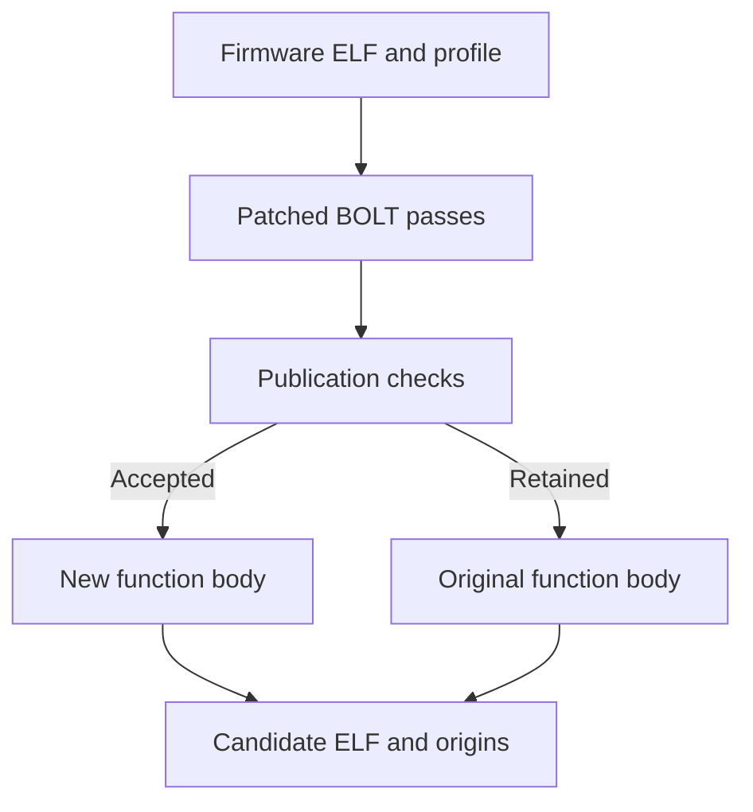

# FirmBOLT

FirmBOLT applies LLVM/BOLT's binary optimization machinery to firmware and checks whether the result can be emitted within the firmware's constraints. Its direct Cortex-M backend understands Thumb instructions, vector entries, literal pools, relocations, and the distinction between executable bytes and data embedded in flash. The default publication path emits a new candidate ELF with qualified function bodies inside their existing ranges and retains the original implementation when a candidate cannot satisfy its checks.

This chapter is pinned to FastDyn's **`firmbolt` branch at `b14f14cb4992d28d56cda5e73685a5f7c432c5cf`**. The branch applies `patches/bolt-fastdyn-preflight.patch` to LLVM **`7864c0736a8a09670dfbfc513f1e9649799f2486`**. The checked-in QEMU gitlink is `99b54836ded8dc3271eba52deee7453efc0a13b9`. [Pinned submodules](https://github.com/boardrunner2049/FastDyn/tree/b14f14cb4992d28d56cda5e73685a5f7c432c5cf/third_party), [patch application](https://github.com/boardrunner2049/FastDyn/blob/b14f14cb4992d28d56cda5e73685a5f7c432c5cf/scripts/preflight/apply-bolt-extension.sh)

FirmBOLT rewrites the **firmware ELF**. The [Supercache optimizer](supercache-optimizer.md) rewrites **saved native translation blocks produced by QEMU**. They operate at different stages and have different input identities, supported transformations, and validation workflows.

## The direct Cortex-M backend

The backend adds an ARM instruction builder, Cortex-M CPU qualification, Thumb symbol handling, ARM relocation support, AArch32 JITLink integration, and annotation-aware emission. Its Cortex-M input is little-endian ELF32 with Thumb code. An explicit `--firmbolt-cortex-m-cpu` must agree with the ELF architecture attributes.

| CPU option | Architecture | What the qualification means |
| --- | --- | --- |
| `cortex-m0`, `cortex-m0plus` | Armv6-M | Thumb-1 decoding, branch/literal handling, and bounded optimization fixtures. |
| `cortex-m3` | Armv7-M | Thumb-2 backend and executable architectural fixtures. |
| `cortex-m4`, `cortex-m7` | Armv7E-M | Feature-qualified decoding; the real FreeRTOS execution fixture uses M4. |
| `cortex-m23`, `cortex-m33` | Armv8-M Baseline/Mainline | Explicit architecture matching; TrustZone instructions fence their containing functions from optimization. |
| `cortex-m55`, `cortex-m85` | Armv8.1-M Mainline | MVE decoding/exact re-emission and PACBTI-M decoding/opaque retention are separately covered. |

This table identifies accepted CPU profiles, not equal execution coverage across every core. ARM-state regions, decode failures, and unsupported effects cause preservation or rejection. DSP, floating-point, MVE, security-state, and authentication instructions do not acquire arbitrary optimization permission merely because the decoder recognizes them. [Backend and CPU checks](https://github.com/boardrunner2049/FastDyn/blob/b14f14cb4992d28d56cda5e73685a5f7c432c5cf/patches/bolt-fastdyn-preflight.patch#L1269-L1410), [qualified scope](https://github.com/boardrunner2049/FastDyn/blob/b14f14cb4992d28d56cda5e73685a5f7c432c5cf/docs/preflight/README.md#direct-bolt-cortex-m-backend)

The audited ARM pipeline is enabled by default. `--firmbolt-arm-full-pipeline=false` selects an identity/emission diagnostic. Production optimization requires an explicit `.isr_vector` section or a validated `vector_table`, `g_pfnVectors`, or `__Vectors` symbol. Exact primary handler entries have a narrow contract for ordinary frame-load forwarding; secondary entries protect the whole containing function.

## What it can optimize

**Frame optimization, or FOP,** is a useful starting point for O0 firmware. A value stored into a stack slot may still be available in a register when the code reloads it. FirmBOLT can replace a qualified reload with a register operation while retaining the original store. Byte and halfword cases use appropriate zero/sign extension, preserving the loaded width rather than accidentally retaining discarded high bits.

The default `--firmbolt-preserve-guest-instruction-count=true` policy retains same-width redundant moves and original explicit branches where ordinary BOLT cleanup would remove instructions. This is a per-function count constraint, not proof of an identical dynamic interrupt or device schedule. Stores, exception returns, instruction origins, and operation-specific admission remain separate obligations.

| Capability | Implemented contract |
| --- | --- |
| Ordinary FOP | `--frame-opt=all` or `hot` selects frame optimization. The ordinary path retains stores; experimental stack-store removal is rejected by the Cortex-M firmware policy. |
| Block layout and branch repair | Profile-driven block ordering, instruction shortening, and bounded relaxation operate with typed references and final placement checks. |
| Direct-call inlining | Requires `--firmbolt-allow-inlining`; emitted callee instructions carry cloned original identities. |
| Tail duplication and propagation | Duplication requires `--firmbolt-allow-tail-duplication`; removal of register definitions through propagation has its own `--firmbolt-allow-tail-duplication-propagation` contract. |
| Loop inversion and double-jump peepholes | Separate `--firmbolt-allow-loop-inversion` and `--firmbolt-allow-control-flow-peepholes` permissions admit the corresponding control-flow changes. |
| Indirect-call and method promotion | Profiled hot targets receive checked guards and an original fallback. Call, tail-call, method-load, ABI, and Thumb-1 literal-read permissions are distinct. |
| Switch and read-only-load simplification | Hot-index promotion uses recovered table identities. Scalar load elision requires `--firmbolt-allow-read-only-load-elision` and qualified immutable data; removing a read also changes its possible fault/event behavior. |

These permission flags accompany the relevant BOLT pass options; they do not individually select every pass. The [qualification runner](https://github.com/boardrunner2049/FastDyn/blob/b14f14cb4992d28d56cda5e73685a5f7c432c5cf/scripts/preflight/run-firm-bolt-cortex-m-port.py#L2217-L2414) contains complete per-fixture combinations and their negative controls. Some explicitly relax the global count policy. Apply those combinations only with the corresponding workload contract.

## Publication is part of the optimization

In the default compact mode, BOLT may analyze and assemble more functions than it ultimately installs. The publication policy selects functions changed by a recorded, audited transformation, checks their final linked bodies, and retains the original bytes when a body is missing, over capacity, incorrectly attributed, or incompatible with the contract.



The default acceptance checks preserve the entry point, program headers, allocated section ranges, and protected vector bytes. New allocated RX/RW ranges are forbidden. Non-allocated ELF metadata can change, so whole-file size and flash occupancy are separate measurements.

Reference handling covers literal loads, ADR, supported MOVW/MOVT references, qualified relocations, and recovered jump tables. Literal bytes are typed data with owners and users. Veneer space comes from qualified capacity inside a caller or explicitly reserved `.firmbolt.veneer` slots, rather than an arbitrary gap. Final reports retain original, cloned, and synthesized instruction identities and linker-resolved output addresses. A rejected function's origins describe the retained original body.

This revision also implements an **explicit relocation mode** using `--relocs --use-old-text`. It can reorder functions within the qualified original `.text` range when retained relocation evidence is available. The checked-in regression verifies moved Thumb entry pointers, calls, code labels, and relocation-section ownership. That mode permits address changes and is separate from the fixed-address lab below; its presence does not establish a whole-application performance result. [Publication and linking implementation](https://github.com/boardrunner2049/FastDyn/blob/b14f14cb4992d28d56cda5e73685a5f7c432c5cf/patches/bolt-fastdyn-preflight.patch#L10304-L10440), [relocation-mode regression](https://github.com/boardrunner2049/FastDyn/blob/b14f14cb4992d28d56cda5e73685a5f7c432c5cf/patches/bolt-fastdyn-preflight.patch#L15132-L15288)

## Lab: create and inspect a Cortex-M3 candidate

This small example uses the checked-in assembly and linker script. It builds a reference ELF, invokes the real backend, and runs the repository's static layout/reference checks. Emulator execution is a separate step in the full gate.

### 1. Build the pinned ARM-enabled BOLT

Use a Linux development host with Git, a working C/C++ toolchain, CMake, Ninja, and Python. The fixture uses the Arm GNU **13.3.Rel1** toolchain; place its `bin` directory on `PATH`. Python 3.12 with the following dependencies supports the inspection runner.

From a fresh checkout:

```bash
git clone https://github.com/boardrunner2049/FastDyn.git FastDyn-FirmBOLT
cd FastDyn-FirmBOLT
git checkout --detach b14f14cb4992d28d56cda5e73685a5f7c432c5cf
git submodule update --init third_party/preflight/llvm-project

python3.12 -m venv firmbolt-env
source firmbolt-env/bin/activate
python -m pip install capstone==5.0.7 pyelftools==0.32

scripts/preflight/apply-bolt-extension.sh
cmake -S third_party/preflight/llvm-project/llvm \
  -B third_party/preflight/llvm-build -G Ninja \
  -DCMAKE_BUILD_TYPE=Release \
  -DLLVM_ENABLE_ASSERTIONS=ON \
  -DLLVM_ENABLE_PROJECTS=bolt \
  -DLLVM_TARGETS_TO_BUILD='X86;ARM;AArch64;RISCV'
cmake --build third_party/preflight/llvm-build \
  --target llvm-bolt llvm-bat-dump llvm-mc yaml2obj --parallel 2
```

The apply script verifies the exact LLVM revision and accepts either a cleanly applicable patch or that same patch already applied. The explicit `ARM` build target matters: the generic `build-bolt.sh` helper at this revision lists X86, AArch64, and RISCV only. The configuration above includes the backend needed here. [Build helper](https://github.com/boardrunner2049/FastDyn/blob/b14f14cb4992d28d56cda5e73685a5f7c432c5cf/scripts/preflight/build-bolt.sh), [ARM build integration](https://github.com/boardrunner2049/FastDyn/blob/b14f14cb4992d28d56cda5e73685a5f7c432c5cf/patches/bolt-fastdyn-preflight.patch#L1-L13)

### 2. Assemble and optimize the fixture

Continue from the repository root in the activated environment. Choose a fresh output directory:

```bash
FIRMBOLT_WORK="$PWD/build/preflight/book-m3"
FIRMBOLT_BIN="$PWD/third_party/preflight/llvm-build/bin/llvm-bolt"
mkdir -p "$FIRMBOLT_WORK"

arm-none-eabi-gcc -mcpu=cortex-m3 -mthumb -nostdlib \
  -Wl,--emit-relocs \
  -Wl,-T,tests/preflight/fixtures/firm_bolt_cortex_m3.ld \
  tests/preflight/fixtures/firm_bolt_cortex_m3.s \
  -o "$FIRMBOLT_WORK/reference.elf"

"$FIRMBOLT_BIN" "$FIRMBOLT_WORK/reference.elf" \
  --firmbolt-cortex-m-cpu=cortex-m3 \
  --firmbolt-arm-full-pipeline --frame-opt=all \
  --eliminate-unreachable=false \
  --fastdyn-firmware-report="$FIRMBOLT_WORK/pass-report.json" \
  --keep-tmp -o "$FIRMBOLT_WORK/candidate.elf"
```

These compiler and backend options follow `build_m3_fixture()` and `run_bolt()` in the [runner](https://github.com/boardrunner2049/FastDyn/blob/b14f14cb4992d28d56cda5e73685a5f7c432c5cf/scripts/preflight/run-firm-bolt-cortex-m-port.py#L748-L758). Keeping unreachable-code elimination disabled avoids treating a reconstructed CFG alone as permission to remove firmware bytes.

The assembly exercises ordinary and narrow stack forwarding, stack-pointer rebasing, and a wide frame. This minimal command supplies no training profile, so it does not reproduce the full gate's separate profiled-layout case.

### 3. Check the emitted artifact

The backend writes `candidate.elf`, a post-pass report, and `pass-report.json.layout.json` with final linked addresses. The following snippet reuses the actual runner's inspection functions:

```bash
python - "$FIRMBOLT_WORK" <<'PY'
import json
import runpy
import sys
from pathlib import Path

work = Path(sys.argv[1])
gate = runpy.run_path("scripts/preflight/run-firm-bolt-cortex-m-port.py")
reference = work / "reference.elf"
candidate = work / "candidate.elf"
native = json.loads((work / "pass-report.json").read_text())
layout = json.loads((work / "pass-report.json.layout.json").read_text())
summary = native["summary"]
assert summary["unmapped_instruction_count"] == 0
assert (
    summary["synthesized_control_edge_instruction_count"]
    == summary["verified_synthesized_control_edge_instruction_count"]
)

checks = {
    "layout": gate["validate_in_place"](
        reference, candidate, {".isr_vector": None}),
    "mapping_symbols": gate["validate_arm_mapping_symbols"](candidate),
    "jump_tables": gate["validate_inline_jump_tables"](
        reference, candidate, layout),
    "pc_relative_data": gate["validate_pc_relative_data_references"](
        reference, candidate, layout),
    "publication": gate["summarize_pass_publication"](
        reference, candidate, native, layout),
}
(work / "static-checks.json").write_text(
    json.dumps(checks, indent=2, sort_keys=True) + "\n")
print(json.dumps(checks["publication"], indent=2, sort_keys=True))
PY
```

Successful checks establish the inspected layout, mapping, provenance, and reference properties. They do not execute the guest or establish equivalence for arbitrary inputs.

Read `selected_function_count`, `byte_changed_function_count`, and rejection reasons separately. An installed body may reproduce the input bytes. Per-pass affected-byte counts can overlap when several transformations touch the same function; `unique_changed_executable_bytes_in_selected_ranges` avoids double-counting. These distinctions are implemented by [the publication summary](https://github.com/boardrunner2049/FastDyn/blob/b14f14cb4992d28d56cda5e73685a5f7c432c5cf/scripts/preflight/run-firm-bolt-cortex-m-port.py#L264-L337).

## Run the complete acceptance gate

The full runner builds architectural fixtures, checks positive and negative cases, and optionally executes them through FastDyn. Its existing environment must provide:

- The patched LLVM checkout and built `llvm-bolt`, `llvm-mc`, and `yaml2obj`.
- Arm GNU 13.3.Rel1 at the runner's fixed `/data/arm-gnu-toolchain-13.3.rel1-x86_64-arm-none-eabi/bin/` location, including GCC and `nm`.
- `/usr/bin/ld.lld-18` for the linked read-only-data fixture.
- The external ESCape32 O0 image at `third_party/preflight/escape32-64k-O0/ESCAPE1-rev12.1.elf`; it is not supplied by a fresh clone.
- A source-built FastDyn runtime for this branch, with its matching QEMU, and permission to use the runner's local QMP sockets.

The Arm compiler, LLD, and ESCape32 image locations are constants in this script; `--bolt` and `--fastdyn` override only their named executables. With those prerequisites satisfied:

```bash
python scripts/preflight/run-firm-bolt-cortex-m-port.py \
  --bolt "$FIRMBOLT_BIN" \
  --fastdyn "$PWD/fastdyn-env/bin/fastdyn" \
  --skip-build --full-pipeline --frame-opt=all \
  --output "$PWD/build/preflight/book-cortex-m-gate"
```

`--skip-build` skips rebuilding BOLT but still builds the firmware fixtures. `--skip-fastdyn` omits runtime execution and records those stages as `skipped_by_request`. Inspect the complete `report.json`, per-case pass/layout reports, and `commands-and-logs/`; a top-level result must be interpreted with its skipped stages.

The gate compares final mapping symbols, protected bytes, PC-relative targets, jump tables, relocation identities, and emitted origins. Its runtime cases compare specified RAM results, including hot/cold fallback paths and selected fault cases. The M4 smoke compares a 2 MiB RAM prefix after 10,000 completed work units with two reference runs. That is finite execution evidence under the fixture's configuration. [Runner options and checks](https://github.com/boardrunner2049/FastDyn/blob/b14f14cb4992d28d56cda5e73685a5f7c432c5cf/scripts/preflight/run-firm-bolt-cortex-m-port.py)

The direct workflow is independent of the older `python -m fastdyn.preflight` identity adapter. At this pin, its generic Python `qualify_firmware()` has not adopted the direct ARM backend. Use the patched `llvm-bolt` and Cortex-M runner for the operations described here.

## Artifacts and execution contracts

The broader firmware wrapper can publish a **FirmwareCandidate v1** containing the image, target, entry points, memory map, origin map, and optimization report. Its publisher hashes those components, checks the staged artifact, and atomically installs a new destination. Loading it rechecks integrity.

That format is consumer-neutral: it contains no FastDyn patch plan, hook binding, device model, or observation trace. Integrity verification does not establish semantic equivalence. The direct Cortex-M command above emits its ELF and reports; it does not automatically package them as a FirmwareCandidate. [Artifact contract and publisher](https://github.com/boardrunner2049/FastDyn/blob/b14f14cb4992d28d56cda5e73685a5f7c432c5cf/src/fastdyn/preflight/candidate.py)

For instrumented execution, addresses and observations remain part of the workload contract. A changed call boundary, removed flash read, different exception-visible stack state, or relocated instruction can affect a hook or fault observer even when the ordinary return value agrees. FirmBOLT's explicit permissions and original-instruction maps expose those distinctions; the existence of a backend or origin map does not imply that arbitrary MPU, interrupt, device, or vulnerability behavior has been verified.

## Evidence and performance

The pinned documentation reports a **28-case v107 production/architectural gate**. Its M4 publication selected 171 of 607 functions, with 127 byte-changing bodies and 678 changed executable bytes. Those are publication statistics. The real ESCape32 image has structural/vector/reference coverage, while original-board/device execution remains unavailable.

The same source reports 55 ARM BOLT lit tests, 11 AArch32 JITLink lit tests, and 19 AArch32 JITLink unit tests passing. Its 208 Core parameterizations comprise **79 passes and 129 explicit skips**. The broad aggregate was not green and was not rerun to completion after the described correction.

These are **source-reported historical results**, not tests repeated for this chapter. Their generated `build/preflight` reports are absent from the checkout, and the patch hash printed in the report differs from the patch at this revision. The recorded environment also retained existing FastDyn/QEMU worktree modifications, so the QEMU gitlink identifies its base rather than a complete executable identity. Requalify an actual build before assigning those results to its output. [Recorded gate and validation scope](https://github.com/boardrunner2049/FastDyn/blob/b14f14cb4992d28d56cda5e73685a5f7c432c5cf/docs/preflight/README.md#direct-bolt-cortex-m-backend), [environment pins](https://github.com/boardrunner2049/FastDyn/blob/b14f14cb4992d28d56cda5e73685a5f7c432c5cf/docs/preflight/pins.json)

The LEMIX evaluation explains why both local mechanisms and completed application work matter:

| Source-reported experiment | Result and boundary |
| --- | --- |
| Exact x86-64 SmartSpeaker accessor | Ordinary FOP reduced a 29-byte body to 24 bytes and reduced CPU cost per call by about 20%. |
| Timer-paced SmartSpeaker application | The reference/FOP ratio was 0.9949 with a 0.9568–1.0166 interval. Equal timer-supplied markers did not establish application capacity. |
| FreeRTOS POSIX queue comparison | Across 30 paired two-million-message blocks, FirmBOLT was about 2.38% slower than O3 while meeting a frozen 5% comparability gate; checksums agreed. This is an x86-64 rehost result. |

These measurements do not establish Cortex-M hardware speed or a universal FastDyn gain. The SmartSpeaker rehost uses zero-backed MMIO mappings, and no hardware-counter claim follows from it. The alias counterexample in the evaluation is equally useful: removing a seemingly private accessor stack store changed behavior when an input pointed into that stack. Ordinary FOP retained the store. [LEMIX evaluation](https://github.com/boardrunner2049/FastDyn/blob/b14f14cb4992d28d56cda5e73685a5f7c432c5cf/docs/preflight/lemix-o0-evaluation.md#3-bolt-findings), [FreeRTOS comparison](https://github.com/boardrunner2049/FastDyn/blob/b14f14cb4992d28d56cda5e73685a5f7c432c5cf/docs/preflight/README.md#firm-bolt-freertos-o0o3-comparison)

For a new experiment, freeze the firmware hash, tool/patch versions, pass options, profile, input set, completion condition, and observation checks. Separate training from held-out selection. Record live code changes, placement repairs, offline cost, and CPU cost per completed unit. Keep an unchanged reference available when a candidate fails acceptance or has no measured benefit.

During this documentation review, three CLI help checks succeeded and a selected Python suite produced **54 passed, 34 skipped, and 2 failed**. Passing checks covered Python artifacts, bounded synthetic contracts, and supplied trace comparisons. The failures occurred while opening absent patched-LLVM source and an absent external SDK example, before their behavioral assertions; the wrapper and policy tests required missing source or generated evidence. No LLVM build, native wrapper acceptance, Cortex-M execution, or benchmark was established by this local run.

## Source guide

- [Direct backend patch](https://github.com/boardrunner2049/FastDyn/blob/b14f14cb4992d28d56cda5e73685a5f7c432c5cf/patches/bolt-fastdyn-preflight.patch): target integration, audited pass scheduling, origins, relocation repair, publication policy, and native regressions.
- [Cortex-M runner](https://github.com/boardrunner2049/FastDyn/blob/b14f14cb4992d28d56cda5e73685a5f7c432c5cf/scripts/preflight/run-firm-bolt-cortex-m-port.py): exact options, fixture construction, independent static checks, runtime cases, and reporting.
- [Firmware fixtures](https://github.com/boardrunner2049/FastDyn/tree/b14f14cb4992d28d56cda5e73685a5f7c432c5cf/tests/preflight/fixtures): bounded positive and negative architecture examples.
- [BOLT-first wrapper](https://github.com/boardrunner2049/FastDyn/blob/b14f14cb4992d28d56cda5e73685a5f7c432c5cf/scripts/preflight/run-bolt-firmware-wrapper.py): supported-host compact import, typed reference repair, and installation checks.
- [FirmwareCandidate v1](https://github.com/boardrunner2049/FastDyn/blob/b14f14cb4992d28d56cda5e73685a5f7c432c5cf/src/fastdyn/preflight/candidate.py): hash-bound artifact publication and loading.
- [Recorded evaluation](https://github.com/boardrunner2049/FastDyn/blob/b14f14cb4992d28d56cda5e73685a5f7c432c5cf/docs/preflight/lemix-o0-evaluation.md): mechanism-level results, acceptance boundaries, measurement methods, and limitations.
