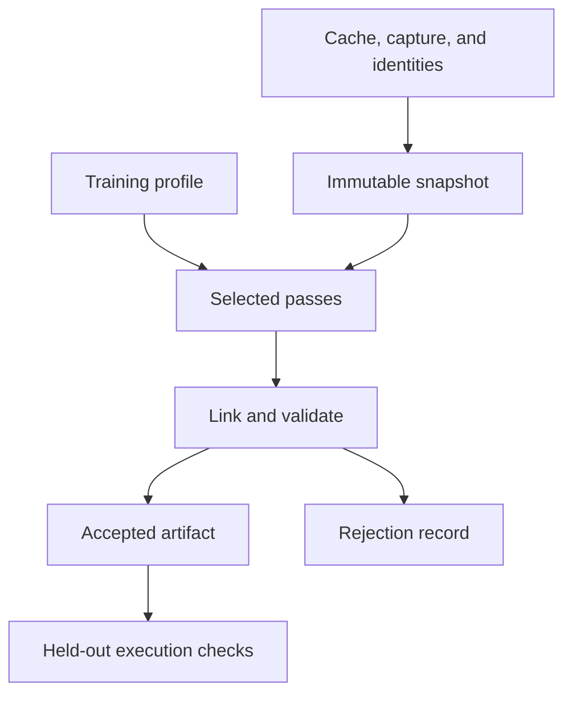

# Supercache optimizer

`scopt` optimizes native code that QEMU has already translated and saved in a Supercache. It can improve the arrangement of translation blocks, specialize selected connections between them, remove proved-dead state stores, and inline supported host helper calls. The firmware ELF remains the input to FastDyn; the optimizer produces a separately validated native-cache artifact.

This chapter covers FastDyn's **`scopt` branch at `124699db203aae581735b4bdfb82e9b949332405`**, paired with **QEMU `934890ed5119ef70da69276991d921573f23ed4f`**. That backend includes capture, profiling, and the v5/v6 loader support needed by these workflows. The earlier [Supercache](supercache.md) chapter explains persistence and cache identity, but its historical build recipe does not produce the metadata required here. Use the matching source and backend for this chapter's lab. [Source lock](https://github.com/boardrunner2049/FastDyn/blob/124699db203aae581735b4bdfb82e9b949332405/tools/scopt/fixtures/host-inline/source-lock.json)

## What the optimizer works on

A saved block contains host machine instructions, references to runtime helpers, links to other blocks, and information used to recover guest state. Moving or rewriting those instructions requires more than a disassembler.

| Input | What it establishes |
| --- | --- |
| `.sc` cache | Native code arena and translation-block records. The current backend writes v5; its loader also accepts the v6 guarded-slot format. |
| `.scm` capture | Instruction extents, native references, literal-pool uses, call provenance, guest instruction boundaries, recovery metadata, and runtime mappings. |
| `.qprof` and merged Profile v1 | Software counts collected from the unoptimized baseline, with explicit phases and input sets. |
| ExecutionBundle and RuntimeIdentity | The firmware, configuration, runtime binaries, and admission facts to which the snapshot belongs. |
| EnvLayout and helper effects | Exact executable-bound descriptions used when a transformation reasons about QEMU state or helper behavior. |

Import combines these inputs into an immutable snapshot. A block's identity includes its translation context, rather than only its guest address. Different cached versions of the same guest block remain distinguishable. Passes propose edits against that snapshot, and the manager tracks which analyses become stale when code, metadata, or layout changes. The linker checks placement and displacement constraints before the artifact is validated and published. [Contracts](https://github.com/boardrunner2049/FastDyn/blob/124699db203aae581735b4bdfb82e9b949332405/tools/scopt/docs/contracts.md), [pass framework](https://github.com/boardrunner2049/FastDyn/blob/124699db203aae581735b4bdfb82e9b949332405/tools/scopt/docs/pass-framework.md)



Capture and profiling are separate runs. In this backend they require non-flat caches, absolute output paths, and fresh output files; they cannot run simultaneously. Profiling disables chaining to obtain its software observations. Its instrumentation therefore belongs to training, outside the final timing campaign. The bootstrap below handles those details. [Capture implementation](https://github.com/boardrunner2049/qemu/blob/934890ed5119ef70da69276991d921573f23ed4f/tcg/sc-capture.c), [profile implementation](https://github.com/boardrunner2049/qemu/blob/934890ed5119ef70da69276991d921573f23ed4f/accel/tcg/sc-profile.c)

## Available transformations

The checked-in pipelines expose distinct optimization experiments. Select one deliberately and inspect its pass results.

| Route | Implemented behavior | Main boundary |
| --- | --- | --- |
| `identity` | Packages the unchanged baseline and checks the identity path. | Establishes the control artifact; an ordinary canonical input is byte-equal after packaging. |
| `b2-layout` | Classifies hot/cold blocks, clusters hot blocks using weighted edges, and orders the remaining sections. | Moves eligible units around fixed obstacles; requires a compatible profile for meaningful ordering. Produces v5. |
| `b3` | Specializes return continuations, propagates constants, folds branches, removes dead host operations, and installs guarded return/static connections. | Uses certified facts, bounded variants, exact runtime admission, and symbolic checks. Guarded artifacts require the v6 loader. |
| `scopt b4 package` | Replaces proved-dead executor-state stores with same-length NOPs. | Register/flag, I/O-state, and plugin-value classes have separate observer rules. Uses bound state layout and proof gates; produces v5. |
| `host-inline` | Replaces eligible helper calls with transfers to appended native helper bodies. | Standalone v5 pipeline; checked x86-64 SysV helpers and exact native images. |
| `host-inline-splice` | Inserts a supported helper body directly into the caller's fall-through path. | Narrow register/argument pattern, one splice per block, with rewritten physical offsets and recovery metadata. |
| `host-inline-extreme` | Considers all captured host calls and independently checks call-site coverage. | Strict mode rejects incomplete coverage. Explicit partial mode publishes only proved edits. |

The B2 and B3 pass names and order are defined in their [pipeline files](https://github.com/boardrunner2049/FastDyn/tree/124699db203aae581735b4bdfb82e9b949332405/tools/scopt/pipelines). The [B4 command](https://github.com/boardrunner2049/FastDyn/blob/124699db203aae581735b4bdfb82e9b949332405/tools/scopt/scopt/commands/b4.py) is the dedicated state-store packaging interface. A separate `scopt sfb package` command repairs an icount-entry store-forwarding pattern; it is a baseline TCG code-shape experiment and should be reported separately from cache optimization.

Native inlining cannot be combined with B3 or layout capabilities in one pipeline at this revision: the CLI rejects that combination. Semantic transformations also have stricter proof requirements than layout changes. An unsupported instruction or unknown helper effect can prevent an edit without invalidating the original baseline. [Optimizer command](https://github.com/boardrunner2049/FastDyn/blob/124699db203aae581735b4bdfb82e9b949332405/tools/scopt/scopt/commands/optimize.py)

## Lab: inline a real QEMU helper

The supplied Cortex-M3 fixture performs **65,536 iterations of 32-bit bit reversal and addition**. QEMU translates its guest `RBIT` instruction into calls to the real `helper_rbit`. FastDyn prints the final register and stops at a benchmark marker. Two seeds train the optimizer; two different seeds validate it. An independent Python arithmetic oracle supplies the expected outputs.

The following workflow is derived from the checked-in [fixture](https://github.com/boardrunner2049/FastDyn/tree/124699db203aae581735b4bdfb82e9b949332405/tools/scopt/fixtures/host-inline) and [bootstrap script](https://github.com/boardrunner2049/FastDyn/blob/124699db203aae581735b4bdfb82e9b949332405/tools/scopt/scripts/bootstrap_host_inline.py). It is a source-locked integration workflow, not a claim that its emulator runs were repeated while writing this chapter.

### 1. Prepare the qualified host

The Python tool requires Python 3.12 or newer. This particular bootstrap requires **Python 3.12 on x86-64 Linux** and checks the exact Ubuntu 24.04 package versions recorded in `source-lock.json`. These include GCC 13.3.0, the recorded Ubuntu binutils 2.42 build, GDB for state-layout extraction, and `binutils-arm-none-eabi` for the guest fixture. Merely installing the newest packages is not the same environment.

The bootstrap also verifies the runtime source, setup-patch hash, QEMU revision, and an `-O2 -g` QEMU build. The runtime sources at this chapter's commit satisfy its recorded starting-revision check. The execution harness uses `setarch x86_64 -R`; the host must permit that execution mode so captures can be reused with stable mappings. Retain the produced binaries and run files through optimization and validation.

From a fresh checkout, run the remaining blocks in the same Bash session and continue only after each command succeeds:

```bash
git clone https://github.com/boardrunner2049/FastDyn.git FastDyn-scopt
cd FastDyn-scopt
git checkout --detach 124699db203aae581735b4bdfb82e9b949332405

python3.12 -m venv scopt-env
source scopt-env/bin/activate
python -m pip install -e 'tools/scopt[test]'
scopt --help
scopt contracts check
```

An editable installation keeps the tool's pipeline and fixture resources available. The Python installation and contract check do not build QEMU or qualify a native cache.

### 2. Capture and qualify the baseline

Choose a work directory that does not exist. The bootstrap creates it, initializes the pinned submodules, invokes the source build, assembles the guest, resolves its marker symbols, and renders the configuration.

```bash
SCOPT_WORK="$PWD/out/scopt-host-inline"
python tools/scopt/scripts/bootstrap_host_inline.py \
  --source-lock tools/scopt/fixtures/host-inline/source-lock.json \
  --work-dir "$SCOPT_WORK"

export SCOPT_ENVLAYOUT_PATH="$SCOPT_WORK/envlayouts"
export FASTDYN_ROOT="$PWD" SCOPT_FASTDYN_SRC="$PWD"
SCOPT_QEMU="$PWD/third_party/common/qemu/build/qemu-system-arm"
SCOPT_SNAPSHOT=$(python -c \
  'import json,sys; print(json.load(open(sys.argv[1]))["snapshot"])' \
  "$SCOPT_WORK/baseline.json")
```

The generated configuration selects `generic-cortexm`, a Cortex-M3 CPU, non-flat Supercache, a file-backed input memory bank, and the existing `benchmark_start`, `printreg`, and `benchmark_end` callbacks. Addresses come from the newly assembled ELF.

Before writing `baseline.json`, the script checks uncached execution, cold and warm cache behavior, captures the training runs, extracts EnvLayout, creates identities, imports a snapshot, collects a steady-phase profile, and packages an identity artifact. It reimports that artifact and checks the snapshot identity. Both held-out inputs must match the arithmetic oracle, with zero appended translation blocks in the warm baseline and identity runs.

Keep `bootstrap.log`, `build-evidence.json`, and the complete output directory. They record the actual commands, package versions, binary digests, captures, profiles, oracle results, and cache-use evidence. Rebuilding the runtime requires a fresh qualification.

### 3. Build the checked native bridge

Host inlining uses `scopt-native`, a bridge to LLVM/BOLT's inliner. It requires CMake, Ninja, **LLVM 20.1.2 development libraries**, and the exact LLVM 20.1.2 source archive. The script defaults to `llvm-config-20`; set `LLVM_CONFIG` to the matching executable if necessary.

With those prerequisites and `curl` available:

```bash
mkdir -p out
curl --fail --location \
  https://github.com/llvm/llvm-project/releases/download/llvmorg-20.1.2/llvm-project-20.1.2.src.tar.xz \
  -o out/llvm-project-20.1.2.src.tar.xz

tools/scopt/native/build.sh \
  "$PWD/out/llvm-project-20.1.2.src.tar.xz" \
  "$PWD/out/scopt-native"
export SCOPT_HOST_INLINE_BRIDGE="$PWD/out/scopt-native/build/bin/scopt-native"
"$SCOPT_HOST_INLINE_BRIDGE" --version
```

The build checks the archive SHA-256 and `llvm-config` version, applies the checked-in BOLT adaptations, and builds the bridge. Its expected version string is `scopt-native bridge 1 (LLVM/BOLT 20.1.2)`. The bridge hash and eligibility policy participate in the optimization's input identity. [Native build and contract](https://github.com/boardrunner2049/FastDyn/blob/124699db203aae581735b4bdfb82e9b949332405/tools/scopt/native/README.md), [build script](https://github.com/boardrunner2049/FastDyn/blob/124699db203aae581735b4bdfb82e9b949332405/tools/scopt/native/build.sh)

### 4. Inspect calls and optimize

The initial inventory shows captured host calls and their profile weights. Those weights are **translation-block entries**, a hotness proxy; they are not exact dynamic call counts.

```bash
scopt host-calls "$SCOPT_SNAPSHOT" \
  --profile "$SCOPT_WORK/profile/merged.profile.json" \
  --out "$SCOPT_WORK/host-calls.json"

scopt optimize "$SCOPT_SNAPSHOT" --pipeline host-inline \
  --profile "$SCOPT_WORK/profile/merged.profile.json" \
  --store "$SCOPT_WORK/inline-store" --json \
  > "$SCOPT_WORK/inline-result.json"

SCOPT_ARTIFACT=$(python -c \
  'import json,sys; d=json.load(open(sys.argv[1])); assert d["status"]=="published"; print(d["artifact_dir"])' \
  "$SCOPT_WORK/inline-result.json")
```

`optimize` exits 0 after publishing an artifact and 2 after rejecting a candidate. A rejection record identifies the failed condition. Publication does not by itself mean that a pass made a change: inspect `ledger.jsonl`, the provenance sidecar, and the coverage report. Outcomes such as `no_change`, `skipped_unsupported`, `skipped_unknown`, or `budget_exhausted` remain meaningful results.

The published directory contains `cache.sc`, its capture metadata, bundle and runtime identity, profile information, `validation.json`, `ledger.jsonl`, and `MANIFEST.sha256`. It is immutable. Its `cache.sc.scopt.json` provenance is distinct from FastDyn's per-run `.sc.fastdyn.json` launch fingerprint. The execution harness deploys a writable copy with the correct launch manifest; do not point QEMU directly at the read-only store artifact. [Linking and publication](https://github.com/boardrunner2049/FastDyn/blob/124699db203aae581735b4bdfb82e9b949332405/tools/scopt/docs/link-validate.md)

### 5. Validate on held-out inputs

```bash
scopt validate "$SCOPT_ARTIFACT" --snapshot "$SCOPT_SNAPSHOT"

scopt validate "$SCOPT_ARTIFACT" --dynamic \
  -c "$SCOPT_WORK/host-inline.toml" --baseline "$SCOPT_SNAPSHOT" \
  --qemu "$SCOPT_QEMU" \
  --inputs "$SCOPT_WORK/heldout-0.bin" \
  --inputs "$SCOPT_WORK/heldout-1.bin" \
  --out "$SCOPT_WORK/inline-v10"

scopt host-calls "$SCOPT_SNAPSHOT" --coverage \
  --artifact "$SCOPT_ARTIFACT" \
  --profile "$SCOPT_WORK/profile/merged.profile.json" \
  --out "$SCOPT_WORK/inline-coverage.json"
```

Static validation checks the packaged v5 artifact and its metadata. Dynamic validation, called **V10**, compares baseline and artifact runs using fresh directories and cache-use evidence. For this fixture, inspect `inline-v10/dynamic.json`: both arms should append zero blocks. The measurement script requires qualifying V10 records before timing and verifies every timed output against the oracle.

This static `scopt validate` interface is for v5 artifacts. B3's v6 artifacts use their packaging checks and the verifying `scopt publish` path. Do not interpret a v5-only parser error as a completed v6 validation.

An ablation using `--disable host-inline` supplies another control; the bootstrap already supplies the identity artifact. To evaluate `host-inline-splice`, repeat optimization and validation with that pipeline name and separate output directories. It shares the same captured baseline and checked bridge, but applies a different rewrite.

## What makes host inlining admissible

The native path binds a call to the captured guest instruction, its helper metadata, its direct displacement or immutable pool reference, and the exact loaded image. It checks the module digest, mapping, load bias, symbol range, and compiled bytes. A rebuild or changed mapping is not interchangeable evidence.

For `host-inline`, the admitted bodies are supported x86-64 SysV integer helpers using registers, ordinary returns, and direct internal control flow. Unsupported memory or stack effects, nested calls, traps, external transfers, and recovery dependencies receive refusals. The BOLT bridge constructs the native control-flow representation and performs inlining; an independent **V24** check verifies the final placed machine bytes, source correspondence, and continuation relocations.

The island form appends helper bodies after the original pool and preserves original guest-instruction offsets. The splice form handles a narrower straight-line pattern: one 32-bit argument enters in `edi`, the return leaves in `eax`, and a suitable adjacent argument load permits removing a redundant copy. It updates physical offsets and the guest recovery search table. Derived capture metadata records those changes for independent reimport.

Both paths assume the audited runtime's normal stack and calling behavior. Their equivalence contract excludes observing eliminated return-address slots or asynchronously unwinding through the removed frame. It qualifies ordinary execution under that contract, rather than arbitrary debugger, unwinder, or interposition behavior. [Island admission and proof](https://github.com/boardrunner2049/FastDyn/blob/124699db203aae581735b4bdfb82e9b949332405/tools/scopt/docs/host-inline.md), [splice admission and proof](https://github.com/boardrunner2049/FastDyn/blob/124699db203aae581735b4bdfb82e9b949332405/tools/scopt/docs/host-inline-splice.md)

The stricter `host-inline-extreme` pipeline also inventories cold and unprofiled calls. Its default is all-or-nothing: a missing or unsupported call prevents publication. `allow_partial=true` is an explicit relaxation recorded in provenance. The current fixture's strict attempt rejects at **2 approved of 6 observed sites**. Partial mode splices `benchmark_start` and the hot `helper_rbit`; the cold RBIT shares the virtual's block, and the format allows only one splice per block. The framed virtual retains its nested clock call. The accepted depth setting is 1 or 2, with 1 the default. This is bounded, checked coverage, not unrestricted recursive inlining. [Extreme-mode implementation and recorded result](https://github.com/boardrunner2049/FastDyn/blob/124699db203aae581735b4bdfb82e9b949332405/tools/scopt/docs/host-inline-extreme.md)

## Measure the result

After the held-out validation succeeds, use a fresh evidence directory:

```bash
python tools/scopt/scripts/measure_host_inline.py \
  --baseline "$SCOPT_WORK" --inline-artifact "$SCOPT_ARTIFACT" \
  --inline-v10 "$SCOPT_WORK/inline-v10/dynamic.json" \
  --out "$SCOPT_WORK/performance" --repetitions 6 --seed 20261118
```

This compares the warm baseline, identity artifact, and inline artifact in an interleaved campaign. It writes the frozen campaign, individual run evidence, and `performance.json`. Keep training and held-out inputs separate, report code growth and skipped sites, and compare equivalent completion conditions. Offline optimization, deployment preparation, and warm firmware execution answer different cost questions; retain all three when judging whether repeated runs amortize the work.

The pinned source documentation reports these **separate campaigns under Rosetta on Apple Silicon**, not physical x86-64 measurements:

| Campaign | Runs | Median paired firmware-time reduction versus its warm baseline | Variation |
| --- | ---: | ---: | --- |
| Native islands | 36 | 3.86% | MAD 2.22 percentage points; pairs ranged from 8.42% faster to 9.79% slower. |
| Fall-through splices | 48 | 5.95% | MAD 4.07 percentage points; pairs ranged from 19.01% faster to 4.29% slower. |

These percentages are paired comparisons, not ratios of pooled medians. The island artifact added 164 bytes across two sites; the splice artifact added 144 bytes. The source reports oracle agreement and zero appended blocks for the measured runs. Per-run deployment preparation was approximately 0.52 seconds for the island campaign and 0.475 seconds for the splice campaign, outside the firmware interval. The island report also records approximately 2.8 seconds of offline selection and bridge work. These results describe one small fixture and its host. [Island measurements](https://github.com/boardrunner2049/FastDyn/blob/124699db203aae581735b4bdfb82e9b949332405/tools/scopt/docs/host-inline.md#measured-fixture), [splice measurements](https://github.com/boardrunner2049/FastDyn/blob/124699db203aae581735b4bdfb82e9b949332405/tools/scopt/docs/host-inline-splice.md#warm-timing)

## Validation level of this chapter

On 18 November 2026, the documentation review installed the Python tool in an isolated environment, ran its CLI and contract checks, and ran a focused existing test selection: **223 passed, 12 skipped, and 25 deselected**. The checks covered synthetic cache formats, pass capabilities, invalidation, linking and rollback, duplicate-key handling, immutable publication, image binding, native correspondence, splice metadata, strict-coverage rejection, and mutation rejection.

Eleven skipped tests require an actual BOLT bridge; one requires real RBIT splice evidence. The pass-framework tests deliberately mock bridge responses where appropriate. No native bridge build, source-locked bootstrap, QEMU execution, or timing campaign was run for this documentation change. The performance figures above are the pinned source's reported results, while the observed local results establish the narrower Python and synthetic contracts. [Existing unit tests](https://github.com/boardrunner2049/FastDyn/tree/124699db203aae581735b4bdfb82e9b949332405/tools/scopt/tests/unit), [mutation checks](https://github.com/boardrunner2049/FastDyn/blob/124699db203aae581735b4bdfb82e9b949332405/tools/scopt/tests/mutation/test_mutation_suite.py)

## Source guide

- [Contracts and formats](https://github.com/boardrunner2049/FastDyn/blob/124699db203aae581735b4bdfb82e9b949332405/tools/scopt/docs/contracts.md): identities, cache records, capture metadata, profiles, and validation stages.
- [Pipeline definitions](https://github.com/boardrunner2049/FastDyn/tree/124699db203aae581735b4bdfb82e9b949332405/tools/scopt/pipelines) and [optimizer CLI](https://github.com/boardrunner2049/FastDyn/blob/124699db203aae581735b4bdfb82e9b949332405/tools/scopt/scopt/commands/optimize.py): supported passes, ablations, capability gates, and publication results.
- [Layout workflow](https://github.com/boardrunner2049/FastDyn/blob/124699db203aae581735b4bdfb82e9b949332405/tools/scopt/docs/b2-layout.md), [cross-block passes](https://github.com/boardrunner2049/FastDyn/blob/124699db203aae581735b4bdfb82e9b949332405/tools/scopt/docs/b3-passes.md), and [state-store reduction](https://github.com/boardrunner2049/FastDyn/blob/124699db203aae581735b4bdfb82e9b949332405/tools/scopt/docs/b4.md): the separate B2, B3, and B4 contracts, commands, and evidence.
- [Fixture bootstrap](https://github.com/boardrunner2049/FastDyn/blob/124699db203aae581735b4bdfb82e9b949332405/tools/scopt/scripts/bootstrap_host_inline.py) and [source lock](https://github.com/boardrunner2049/FastDyn/blob/124699db203aae581735b4bdfb82e9b949332405/tools/scopt/fixtures/host-inline/source-lock.json): the complete qualified build, capture, profile, oracle, and identity workflow.
- [Native bridge](https://github.com/boardrunner2049/FastDyn/blob/124699db203aae581735b4bdfb82e9b949332405/tools/scopt/native/scopt_native.cpp) and [native passes](https://github.com/boardrunner2049/FastDyn/blob/124699db203aae581735b4bdfb82e9b949332405/tools/scopt/scopt/passes/host_inline.py): actual BOLT integration and checked island/splice proposals.
- [V24 native correspondence](https://github.com/boardrunner2049/FastDyn/blob/124699db203aae581735b4bdfb82e9b949332405/tools/scopt/scopt/validate_sym/native_inline.py) and [splice checks](https://github.com/boardrunner2049/FastDyn/blob/124699db203aae581735b4bdfb82e9b949332405/tools/scopt/scopt/validate_sym/native_splice.py): the admitted observation and machine-code contracts.
- [Measurement driver](https://github.com/boardrunner2049/FastDyn/blob/124699db203aae581735b4bdfb82e9b949332405/tools/scopt/scripts/measure_host_inline.py): held-out acceptance, paired execution, and performance evidence.
