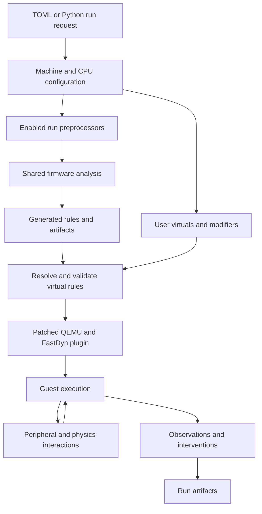

# The execution pipeline

FastDyn turns a description of an experiment into an executable firmware environment. The same run can combine a firmware image, peripheral models, instruction-triggered interventions, observation plugins, and a physics backend. The central design choice is to prepare as much information as possible on the host, then give the native execution engine a compact description of what to do.

This creates three useful places to work: **configuration** describes the experiment; **host preparation** resolves firmware facts and builds instrumentation; **execution** runs the guest and applies the prepared behavior. A feature can use one or several of these stages without becoming a special case in the command-line frontend.

## From a configuration to an experiment

The Python run API and CLI share the run machinery. Configuration parsing builds the machine, CPU, memory, device, and plugin settings. The frontend prepares the work directory, optional FMU inputs, and other run resources before launching QEMU.

An enabled **run preprocessor** receives its own configuration table and a `RunContext`. It can query the firmware, write a schema or manifest, and return generated virtual instructions. Function Counter, for example, selects ELF function entries and generates one hook per selected entry. Introspection determines RTOS hooks and prepares a schema for the native walker.

FastDyn combines these generated hooks with explicit user rules and rules loaded through `existing_config_path`. It resolves trigger addresses, performs any per-virtual preparation, checks declared capabilities, and rejects conflicting virtual callbacks at a PC. Identical virtual rules are deduplicated. Modifiers have a separate serialization path and exact-line deduplication.

The resulting rule files are runtime inputs, not edits to the firmware:

| Location under the work directory | Role |
| --- | --- |
| `virtuals/virtuals.txt` | Prepared trigger PCs, callback names, and argument strings |
| `virtuals/modifiers.txt` | Prepared inline state-update rules |
| `virtual-artifacts/` | Data produced by individual virtual preprocessors |
| `run-artifacts/<plugin>/` | Run-plugin schemas, manifests, observations, and final results |

Native plugins resolve their own artifact names through the runtime SDK. A plugin therefore does not need to add a QEMU command-line option for each generated file.

## What happens during translation

QEMU translates guest instructions into host-executable code in translation blocks. FastDyn's block-translation callback inspects the guest instruction addresses in a block and installs the configured instrumentation at matching PCs.

There are two principal execution mechanisms:

| Mechanism | Installed during translation | Action when the guest reaches the PC |
| --- | --- | --- |
| Virtual instruction | An instruction execution callback | Invoke the registered native C behavior |
| Modifier | A specialized inline operation in the patched QEMU path | Update the configured register or memory state |

The translation callback prepares instrumentation; it does not execute a firmware event merely because a block was translated. The installed action runs when the translated guest instruction executes, including subsequent executions of a cached block. This distinction matters for loops, counters, interrupts, and timing experiments.

The native core registers instrumentation in the following order within its instruction loop: coverage/register logging, a virtual callback, specialized inline I/O, modifiers, and legacy detours. This describes the current implementation's registration order. It is not a substitute for checking the semantics of overlapping interventions, especially interventions that change control flow.

## The existing inline-I/O foundation

FastDyn already contains a specialized path that associates a known guest PC with an inline I/O load or store. `[Machine].finline` selects a user-supplied access-map file; the frontend forwards that path to the native parser. Each parsed record contains a PC, read/write direction, device name, offset, and register. The translation callback then installs `QEMU_PLUGIN_INLINE_LOAD_IO` or `QEMU_PLUGIN_INLINE_STORE_IO`.

The current implementation addresses a global `gpio_memory[0x400]` buffer. The record's device name is parsed but does not choose a separate device backing block in this path. It is a concrete foundation for avoiding normal callback dispatch at selected accesses, with a narrow current contract. It does not yet constitute general automatic analysis of arbitrary device models or automatic installation of safe fast paths. The [automatic MMIO design](../designs/automatic-mmio.md) explains that next step.

## Runtime models and observations

During execution, device dispatch handles the configured peripheral accesses. Runtime plugins may observe MMIO after dispatch, react to guest IRQ events, inspect translated blocks, or install prepared PC callbacks. Physics integration exchanges actuator commands and simulated state through its selected backend. These interfaces allow a model, a tracer, and an experiment controller to coexist while retaining distinct responsibilities.

Results remain in the work directory. Some artifacts, such as Introspection's activity log, are updated during execution. Others, such as Function Counter's final sorted totals, depend on normal shutdown callbacks. Stop a run cleanly when its result contract includes exit-time output.

## Architecture is a property of each layer

The execution framework is not synonymous with Cortex-M. FastDyn exposes register/ABI headers for ARM32, Cortex-M, AArch64, RV64, and x86-64, and the source includes architecture-specific configurations and adapters. Individual analyses have their own scope: the shared instruction decoder, VariableWatch's candidate analysis, and ObjectSan's planner currently require ARM Thumb/M-profile.

Select the guest architecture, machine, CPU, instruction mode, and plugin together. An execution backend supporting an architecture does not imply that every analysis or peripheral model supports it.

## Source guide

- [Generic run lifecycle](https://github.com/boardrunner2049/FastDyn/blob/f9666d7f518c373e89831d8e14a6371a27fe6436/src/fastdyn/runner.py)
- [Preparation contexts, plugin discovery, and rule validation](https://github.com/boardrunner2049/FastDyn/blob/f9666d7f518c373e89831d8e14a6371a27fe6436/src/fastdyn/virtual_preprocessing.py)
- [QEMU command and rule-file construction](https://github.com/boardrunner2049/FastDyn/blob/f9666d7f518c373e89831d8e14a6371a27fe6436/src/fastdyn/targets/qemu_target.py)
- [Native translation instrumentation and inline-I/O table](https://github.com/boardrunner2049/FastDyn/blob/f9666d7f518c373e89831d8e14a6371a27fe6436/core/core.c)
- [Public native runtime SDK](https://github.com/boardrunner2049/FastDyn/blob/f9666d7f518c373e89831d8e14a6371a27fe6436/include/fastdyn_runtime.h)
