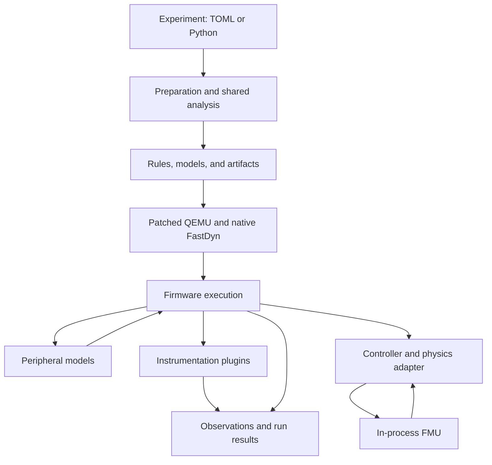

# The system model

FastDyn is an execution engine for firmware experiments. Its inputs describe both the guest and the world visible to that guest. Its outputs describe what happened during the run. The framework makes those inputs and observations explicit enough to reuse them across analyses, target adaptations, and larger experiment drivers.

## The main components

The experiment description identifies a machine, CPU, firmware image, memory map, and optional features. Host preparation resolves information such as a function address or a structure member offset before QEMU starts. The native plugin then applies the resulting plan through QEMU's execution and translation hooks.

The [execution pipeline](execution-pipeline.md) describes the ordering in detail. This chapter explains why the components are separate and how to reason about the whole experiment.

## The guest and its environment

The **guest** is the firmware running on the selected emulated CPU and machine. Its instructions, registers, address space, exceptions, and software state belong to that execution environment. The host is the machine running FastDyn and its models. A host pointer, a guest address, and an offset within a peripheral register bank are different values, even if they share an integer representation.

Peripheral models implement the interactions a firmware access encounters. Depending on the experiment, a device may be represented by a C state machine, a trace, a physical-board connection, or an existing QEMU device. A controller adapter may instead bridge a higher-level data boundary, such as a sensor sample or actuator output.

The chosen boundary determines what the run can establish. A correctly flying firmware slice can provide evidence about its executed control path while leaving bypassed hardware initialization untested. A register-level model can exercise a driver but still depend on the accuracy of its device semantics. FastDyn supplies the execution and integration mechanisms; the experiment author selects and records the abstraction.

## Preparation and execution have different jobs

Preparation is a good place for expensive or repeated information recovery: reading an ELF, resolving aliases, inspecting DWARF, locating functions, selecting instrumentation points, validating layouts, and building an FMU when needed. The shared analysis session lets several preprocessors reuse immutable facts from the same image.

Execution is a good place for work that depends on live state: servicing an MMIO access, reading registers, updating device state, recording an interrupt event, or advancing the plant at the configured time boundary. Keeping image analysis out of hot callbacks makes plugins easier to understand and avoids repeating work on every guest event.

| Concern | Owner |
| --- | --- |
| Parse and launch the experiment | Generic Python frontend and run API |
| Recover reusable firmware facts | `fastdyn.host` and target-aware analysis helpers |
| Decide which functions or accesses matter to one feature | That feature's host preprocessor |
| Execute a virtual callback or observation hook | That feature's native runtime |
| Implement device registers and side effects | Device model |
| Convert controller values and layouts to the plant contract | Flight-controller or world adapter |
| Evolve physical state | Selected physics backend and model |
| Select campaign goals, policies, and result interpretation | Experiment driver or downstream tool |

The ownership rule prevents a feature from turning the core into a collection of target-specific cases. A new firmware can usually be adapted through configuration, profiles, and plugins while preserving the generic runner.

## Time is part of the model

FastDyn experiments may observe host elapsed time, guest virtual time, executed-instruction progress, and a physical model's simulation time. These clocks answer different questions. Host timing measures cost. Guest time drives firmware-visible timeouts and scheduling. Physics time determines the plant's state evolution.

A model step must follow the experiment's chosen synchronization contract. Making the host faster should not silently change a controller's simulated sensor cadence. Conversely, a guest instruction budget is not a measurement of a physical processor's cycle timing. Read [physics timing](../simulation/physics-and-fmu.md) and [performance measurement](../analysis/performance.md) before comparing rates.

## Artifacts are the boundary between stages

Prepared rules, schemas, manifests, and compiled models make the run inspectable. Runtime plugins write their observations under their artifact namespace. Experiment drivers can retain those products alongside the firmware and configuration to explain both what was requested and what was observed.

This structure supports three styles of work: a small hand-written experiment, a preparation plugin that derives instrumentation automatically, and a downstream system that repeatedly drives FastDyn through its API. They share the engine while making different decisions about the experiment.

## Source guide

- [Run lifecycle](https://github.com/boardrunner2049/FastDyn/blob/f9666d7f518c373e89831d8e14a6371a27fe6436/src/fastdyn/runner.py)
- [Preparation API](https://github.com/boardrunner2049/FastDyn/blob/f9666d7f518c373e89831d8e14a6371a27fe6436/src/fastdyn/virtual_preprocessing.py)
- [Runtime SDK](https://github.com/boardrunner2049/FastDyn/blob/f9666d7f518c373e89831d8e14a6371a27fe6436/include/fastdyn_runtime.h)
- [Device dispatch](https://github.com/boardrunner2049/FastDyn/blob/f9666d7f518c373e89831d8e14a6371a27fe6436/device_models/dev.c)
- [Ownership and extension conventions](https://github.com/boardrunner2049/FastDyn/blob/f9666d7f518c373e89831d8e14a6371a27fe6436/docs/CodingConventions.md)
