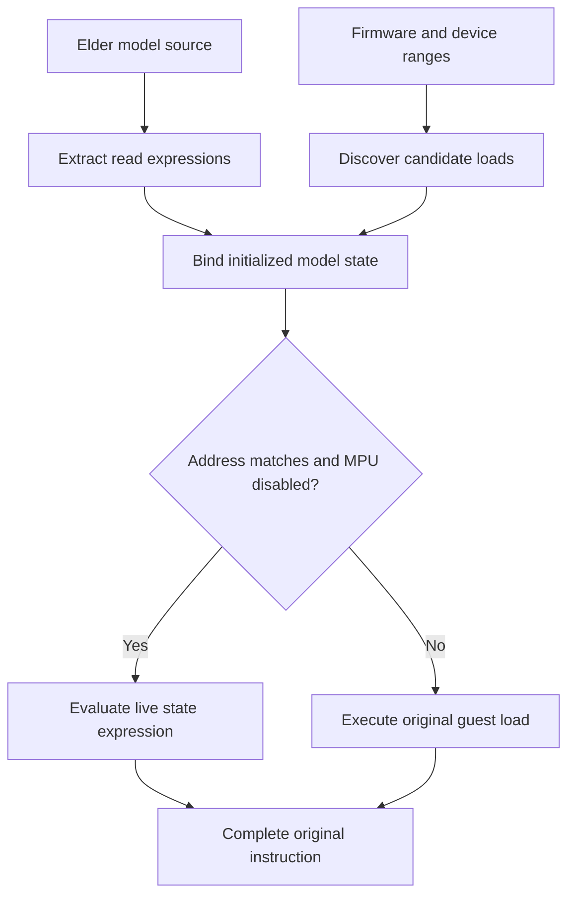

# Automatic MMIO optimization

**Status: implemented experimental workflow at FastDyn [`a38af40`](https://github.com/boardrunner2049/FastDyn/commit/a38af408451394ea2f41be1e9cf1e96bc46c370f).** FastDyn can extract read expressions from an ordinary elder model, discover matching firmware loads, bind them to the initialized device instance, and emit guarded replacements. The shipped echo-model demonstration exercises this complete path. The current extractor has correctness gaps, so an accepted operation is not a proof of equivalence for arbitrary model code; use explicitly audited models and the validation boundaries below.

The workflow needs neither a hand-written PC list nor a second register description. Model compilation produces operation metadata; run preparation finds candidate accesses; native initialization binds those candidates to the model's existing state. Guest loads with an admitted replacement can read that live state directly, while other operations retain ordinary device dispatch.

This is a separate mechanism from the manual [inline device modeling](../advanced/inline-device-modeling.md) access map and the [JIT patcher](../advanced/jit-patcher.md). Automatic MMIO replaces a load inside the decoder's instruction implementation. It does not insert an extra guest instruction or require a PC modifier to skip the original access.

## Build the matching revision

The [installation chapter](../getting-started/installation.md) supplies the Ubuntu 24.04 build prerequisites. Its core walkthrough uses an older source snapshot, so select this feature's revision explicitly. Also provide **Clang 18 or a compatible `clang`**, GNU Arm Embedded assembler/linker tools (`arm-none-eabi-as`, `arm-none-eabi-ld`), and the normal GLib development headers and `pkg-config`. Setup installs the Python dependencies used for firmware decoding and ELF analysis.

For a separate checkout:

```bash
git clone https://github.com/boardrunner2049/FastDyn.git FastDyn-mmio
cd FastDyn-mmio
git checkout --detach a38af408451394ea2f41be1e9cf1e96bc46c370f
git submodule update --init --depth 1 third_party/common/qemu
source ./setup.sh --build-qemu \
  --qemu-root "$PWD/third_party/common/qemu" --skip-optifuzz
```

Run the remaining commands from this **FastDyn repository root**. An existing checkout at the same revision is also suitable. Setup builds `qemu-system-arm` and `build/libfastdyn.so` with device-model support. Its ordered QEMU patch series is:

1. `qemu-fastdyn-plugin-icount.patch`.
2. `qemu-fastdyn-insn-fragments.patch`.
3. `qemu-fastdyn-mmio.patch`.

The setup script detects an already applied prefix and applies the remaining patches. It rejects an incompatible checkout instead of resetting it. Use matching QEMU headers, executable, plugin, and model library; the runtime SDK now includes the required `qemu/fastdyn-mmio.h` ABI.

## Start with the shipped demonstration

```bash
FASTDYN_KEEP_TEST_TMP=1 tests/integration/run_fastdyn_mmio_opt.sh
```

The runner prints the temporary artifact directory, assembles a Cortex-M4 Thumb fixture, builds the unmodified `tests/models/elder_echo.c` with MMIO metadata, and creates complete optimized and baseline configurations. It runs both, checks their firmware success markers, validates the optimized installation report, and prints fresh timing measurements. Keeping the temporary directory lets you inspect its generated models, configurations, logs, and work directories.

Expected success markers include:

```text
PASS automatic MMIO substitution
PASS generated operations, guarded substitution, live state, IRQ polling, widths, MPU/guard fallback, retranslation, and slow path
```

These are the runner's expected assertions, not a claim that this handbook update executed the firmware test. The fixture checks ordinary writes updating later fast reads, byte and halfword transfer widths, an IRQ callback advancing a polled field, a constant register, an unsupported offset, a PC used for both MMIO and RAM, enabled-MPU fallback, and translation-block invalidation. Its final loop performs one million reads.

The script assembles and links an ELF; it does not strip that ELF. The discovery service is designed to recover addresses without symbols, but that broader property should be distinguished from the particular image produced by this runner.

The default executables are `third_party/common/qemu/build/qemu-system-arm`, `build/libfastdyn.so`, and `fastdyn-env/bin/fastdyn`. Override them with `FASTDYN_QEMU_BIN`, `FASTDYN_PLUGIN_LIB`, and `FASTDYN_BIN`. Without `FASTDYN_KEEP_TEST_TMP=1`, the runner deletes its temporary directory on exit.

## Build and configure your model

The public model-build command enables extraction explicitly:

```bash
fastdyn build-model --mmio-opt --no-vio \
  tests/models/elder_echo.c -o out/mmio-models --json
```

This produces `out/mmio-models/elder_echo.so` and `elder_echo.mmio.json`. The shared library retains its normal `fastdyn_model` descriptor and includes a generated `fastdyn_mmio_model` table. The JSON file is an inspection report; the runtime reads the embedded table, so copying a JSON file beside an ordinary library does not enable optimization.

`--mmio-opt` selects `clang-18` when available, otherwise `clang`, rather than the ordinary `CC` selection. The analyzer compiles host LLVM IR with `-O1` and uses that host layout to derive state offsets. Build the analysis and library for the same host ABI. `--no-vio` avoids the optional LibVIO dependency for this echo example; it is not the optimization switch. `--json` prints the build result, including each model's `mmio_operations` count.

The current extractor requires **one C source file per model**. A directory can still contain several independent models, but combining several sources into one model with `--name` is unsupported for this pass. If no admissible operation is found, the requested optimized build fails and removes an older output library. To retain ordinary execution for such a model, build it without `--mmio-opt`.

Extend an existing single-CPU Cortex-M configuration with the following settings. Replace the absolute library path with the output you just built; this fragment supplies device/plugin settings, not a complete machine configuration:

```toml
[CPU.cpu0.plugins.mmio_opt]
enabled = true

[Device.Models.elder]

[Device.echo]
ranges = [["0x40010000", "0x400100ff"]]
irq = [16]
reset = 287454020

[[Device.echo.handlers]]
model = "elder"
enabled = true
scroll = "/absolute/path/to/out/mmio-models/elder_echo.so"
```

The plugin currently consumes only its `enabled` setting. It obtains device ranges and the firmware analysis session from the ordinary run context; there are no user-facing PC, register, or expression lists to maintain. Keep `[Machine].finline = "None"` for this workflow. The complete smoke configuration uses `arch = "arm"`, `machine = "cortexm"`, `cpu = "cortex-m4"`, `coverage = false`, and `twintrace = "None"`.

For a comparison, create a second configuration with `mmio_opt.enabled = false`, use a separate work directory, and keep the firmware, compiled model, initial state, and execution policy fixed. Disabling the plugin leaves the same library usable through its ordinary elder callbacks.

## From model source to a guarded load



The model pass starts from the constant `fastdyn_model` initializer. It resolves the initialization/read callbacks and attempts to establish the state allocation's size. Generated selectors identify an address from a constant, an initialized state field, or that field plus an offset. Expressions can return constants, load unsigned 8/16/32-bit state, and apply bounded add, subtract, bitwise, and shift operations. Each postfix expression has at most 16 operations. Models do not author this metadata table themselves.

The firmware pass uses the shared, cached `ctx.analysis.constant_propagation` service for ELF inputs. It follows vector/ELF entry points and direct control flow and attempts bounded constant propagation through literal loads, `movw`/`movt`, register copies, and immediate arithmetic. The MMIO plugin filters the resulting address candidates against configured device ranges. It distinguishes the instruction's encoded length from the memory transfer width. Undiscovered sites use ordinary execution. The [host-analysis chapter](../extending/host-analysis.md) records the current limits of these candidates; the API's `KnownMemoryAccess` name does not establish a complete dataflow proof.

The native module loads its pending plan during plugin initialization and registers `virtual_register_post_device_init()` work. After `dev_init`, elder resolves each candidate against an initialized device and its `opaque` allocation. `virtual_register_mmio_replacement()` installs the typed descriptor and copied expression; the state pointer remains bound to the live allocation. Register before guest execution: load translation seals the registry, and normal TB invalidation does not discard it.

At execution, the fast branch checks the actual effective address and the enabled MPU state. A matching load evaluates the expression from live model state. An address mismatch or enabled MPU runs the original QEMU load. The surrounding decoder retains destination placement, predication, writeback, PC advancement, and original instruction accounting. This preserves the existing instruction structure; the remaining fault-equivalence limitations are described below.

## Supported scope and compatibility gates

The automatic runtime path currently targets **little-endian Cortex-M Thumb scalar `LDR`, `LDRB`, and `LDRH`**, with 1-, 2-, or 4-byte transfers. It does not optimize writes. Signed loads, wider transfers, other guest architectures, and arbitrary device side effects are outside this workflow.

| Condition | Current behavior |
| --- | --- |
| More than one CPU | Preparation error: one serialized CPU is required |
| Architecture other than `arm`, or machine other than `cortexm`/`cortexm7` | Preparation error |
| No configured device ranges | Preparation error |
| Coverage, edge coverage, fuzzing, manual `finline`, twintrace, hardware trace, or exact-budget capability enabled | Optimization disabled; `installation.json` records `disabled_reason`, and no pending plan is used |
| A write, missing generated model metadata, unresolved instance, or unsupported expression | Site declined; original execution remains |
| Admitted site with a different live address or enabled MPU | Guarded fallback to the original load |

The capability names checked by the host plugin are exactly `coverage`, `edge_coverage`, `fuzzing`, `finline`, `twintrace`, `hardware_trace`, and `exact_budget`. This list is not a universal detection system for every custom observer or runtime extension.

The current plan and replacement registries each hold up to 4096 records; the ARM load emitter considers up to 64 matching records for a PC and width. A successful registration does not prove that a site was reached or that its target load was emitted through the fast path. Check execution counters as well as installation status.

## Read the generated artifacts

| Artifact | What it establishes |
| --- | --- |
| `<model>.mmio.json` beside the library | Read callback, claimed state size, operation count, declined-path count, selectors, and expression instructions produced by model analysis |
| `run-artifacts/mmio_opt/discovery.json` | Firmware path, configured ranges, decoded access records, and discovery/plan preparation time |
| `run-artifacts/mmio_opt/pending-plan.txt` | Model-independent rows: PC, address, transfer size, instruction size, and direction |
| `run-artifacts/mmio_opt/installation.json` | Prepared and registered counts; per-site address, width, device, hook ID, installation reason, fast count, and guarded fallback count |

`installation.json` first contains a pending-device-initialization marker, is rewritten after binding, and is updated with counters by the exit callback. Stop normally when you need final counts. Its `installed` field means QEMU accepted a registration; `fast_count` establishes actual fast executions. `fallback_count` counts the emitted guarded slow branch, not every unoptimized access in the run. Where several records match one instruction and width, that branch is counted against the first matching record.

`discovery.json`'s `preparation_seconds` measures firmware discovery and plan creation. It excludes model compilation, native device binding, and guest execution. The model report counts declined paths but does not provide a detailed reason for every such path. Treat each artifact as evidence of its own stage.

## Current validation limits

The implementation is useful for the audited echo-style workload, but the extractor is not a complete proof of model purity or address semantics. Focused LLVM-IR checks during this handbook review reproduced accepted cases with lost read-to-clear stores and volatile accesses, incorrect offsets derived from scalar TBAA metadata, mutable address selectors, and lost narrow-integer wraparound. These checks exercised the analyzer directly; they were not compiled-C or emulator reproductions. Keep such model shapes on ordinary dispatch until their analysis and equivalence checks are established.

The native fast branch also needs a narrower fault and observation contract:

- **Alignment:** the guard checks address equality and MPU enablement, but does not reproduce every original-load alignment check. Restrict experiments to naturally aligned accesses; the reviewed backend does not establish equivalence for an unaligned access with `CCR.UNALIGN_TRP` enabled.
- **Observers and logs:** fast reads bypass ordinary device dispatch, `virtual_notify_mmio`, and ordinary `io.log` records. Registering a custom MMIO observer does not automatically disable optimization. Leave optimization off when complete per-access observation is required.
- **State lifetime:** fast and ordinary reads share the initialized allocation, so normal model writes and IRQ callbacks can update values later read fast. Live device rebinding, arbitrary external writers, and complete snapshot/reset equivalence need their own contracts; registration does not supply them.

The demonstrated boundary here is the explicit build/preparation/registration workflow and the echo fixture. Automatic write optimization, broader architectures, complete effect analysis, and comprehensive fault/observer equivalence remain work beyond this revision.

## Evidence and the recorded measurement

The checked-in [reference result](https://github.com/boardrunner2049/FastDyn/blob/a38af408451394ea2f41be1e9cf1e96bc46c370f/tests/integration/mmio_opt/reference-results.json) reports the following for the echo demonstration:

| Recorded quantity | Checked-in value |
| --- | --- |
| Model operations / declined model paths | 4 / 1 |
| Discovered / installed / declined sites | 12 / 10 / 2 |
| Fast executions / guarded fallbacks | 1,000,010 / 3 |
| Original-path QEMU execution | 1.0822 seconds |
| Optimized QEMU execution | 0.0419 seconds |
| Discovery and plan preparation | 0.0321 seconds |

These are **source-reported measurements**, not fresh results from this documentation update. The optimization also removes ordinary dispatch logging for the fast reads, so the comparison includes reduced logging work. It does not preserve a complete original MMIO trace. The runner checks behavior and minimum counter thresholds, then reports local timings; it does not require those exact durations or counts.

The [CI run for this revision](https://github.com/boardrunner2049/FastDyn/actions/runs/43115345487) completed its build, then reported **337 unit tests passed and two failed**. The failures concern symbol aliases and inferred function ranges in `test_host_analysis.py`; later integration steps were skipped. Those results do not identify the new MMIO pipeline as the cause of the failures. The pinned [CI workflow](https://github.com/boardrunner2049/FastDyn/blob/a38af408451394ea2f41be1e9cf1e96bc46c370f/.github/workflows/ci.yml) also does not invoke `run_fastdyn_mmio_opt.sh`, so run the demonstration explicitly when validating this feature.

During this handbook update, three dependency-free assertions from `tests/unit/test_mmio_model.py` were executed directly and passed: effectful-call rejection, supported postfix arithmetic, and live-state-branch rejection. The local targeted pytest invocation could not start because pytest was absent; the environment also lacked the other analysis dependencies. No local QEMU build or firmware integration run was performed. The additional direct analyzer probes described above revealed accepted unsafe cases beyond the passing assertions.

Before applying it to another model, compare firmware outcomes, model state changes, required faults, and required observations against the ordinary run. Then use [the performance workflow](../analysis/performance.md) to report preparation and execution costs separately.

## Source guide

- [Current feature overview](https://github.com/boardrunner2049/FastDyn/blob/a38af408451394ea2f41be1e9cf1e96bc46c370f/docs/AutomaticMMIOOptimization.md), [CLI option](https://github.com/boardrunner2049/FastDyn/blob/a38af408451394ea2f41be1e9cf1e96bc46c370f/src/fastdyn/main.py), and [model builder](https://github.com/boardrunner2049/FastDyn/blob/a38af408451394ea2f41be1e9cf1e96bc46c370f/src/fastdyn/model_build.py)
- [LLVM model extractor](https://github.com/boardrunner2049/FastDyn/blob/a38af408451394ea2f41be1e9cf1e96bc46c370f/src/fastdyn/mmio_model.py) and [generated metadata ABI](https://github.com/boardrunner2049/FastDyn/blob/a38af408451394ea2f41be1e9cf1e96bc46c370f/include/fastdyn/device_model.h)
- [Shared constant propagation](https://github.com/boardrunner2049/FastDyn/blob/a38af408451394ea2f41be1e9cf1e96bc46c370f/src/fastdyn/host/constants.py), [plan/report construction](https://github.com/boardrunner2049/FastDyn/blob/a38af408451394ea2f41be1e9cf1e96bc46c370f/src/fastdyn/mmio_plan.py), and [host plugin gates](https://github.com/boardrunner2049/FastDyn/blob/a38af408451394ea2f41be1e9cf1e96bc46c370f/virtuals/mmio_opt/host/preprocessor.py)
- [Runtime binding and reports](https://github.com/boardrunner2049/FastDyn/blob/a38af408451394ea2f41be1e9cf1e96bc46c370f/virtuals/mmio_opt/runtime/mmio_opt.c), [elder instance resolution](https://github.com/boardrunner2049/FastDyn/blob/a38af408451394ea2f41be1e9cf1e96bc46c370f/device_models/elder/elder.c), [ordinary device dispatch](https://github.com/boardrunner2049/FastDyn/blob/a38af408451394ea2f41be1e9cf1e96bc46c370f/device_models/dev.c), and [public runtime SDK](https://github.com/boardrunner2049/FastDyn/blob/a38af408451394ea2f41be1e9cf1e96bc46c370f/include/fastdyn_runtime.h)
- [QEMU guard and expression lowering](https://github.com/boardrunner2049/FastDyn/blob/a38af408451394ea2f41be1e9cf1e96bc46c370f/patches/qemu-fastdyn-mmio.patch) and [ordered patch setup](https://github.com/boardrunner2049/FastDyn/blob/a38af408451394ea2f41be1e9cf1e96bc46c370f/scripts/setup/qemu.sh)
- [Integration runner](https://github.com/boardrunner2049/FastDyn/blob/a38af408451394ea2f41be1e9cf1e96bc46c370f/tests/integration/run_fastdyn_mmio_opt.sh), [fixture/configuration](https://github.com/boardrunner2049/FastDyn/tree/a38af408451394ea2f41be1e9cf1e96bc46c370f/tests/integration/mmio_opt), and [analyzer unit assertions](https://github.com/boardrunner2049/FastDyn/blob/a38af408451394ea2f41be1e9cf1e96bc46c370f/tests/unit/test_mmio_model.py)
