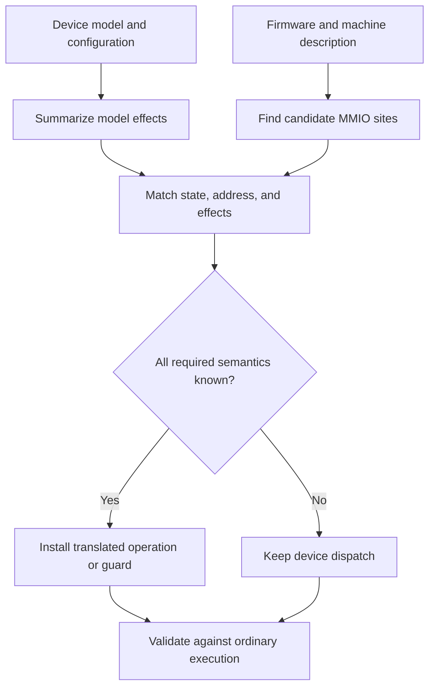

# Automatically accelerate MMIO

**Status: proposed automation.** FastDyn already has device dispatch, a hardcoded-MMIO discovery helper, and a specialized `finline` path. The missing general capability is a tool that analyzes a device model, finds eligible firmware accesses, and installs correct fast paths automatically.

The goal is to keep simple operations in translated execution while preserving the model's full behavior for operations that need it. A status read might be a load from shared device state. A transmit command might need a queue, a callback, an interrupt, or external I/O and therefore remain on the ordinary dispatch path.

## Analyze behavior, not just register names

Calling a register `STATUS` does not make its reads pure. It might clear a pending bit, consume a FIFO entry, sample a timer, or acknowledge an interrupt. The optimizer must reason about the actual model implementation and all relevant helper calls.

A practical design analyzes a model's compiled intermediate representation together with the model ABI and configuration. It summarizes a read or write by access width, offset, value computation, memory effects, possible callbacks, and externally visible effects. It may use annotations to describe an external helper, but the normal workflow should not require an author to manually enumerate every fast register.

| Model behavior | Candidate action |
| --- | --- |
| Read a stable field from shared state | Inline a load when coherence and width are established |
| Return a constant with no side effects | Inline a constant result |
| Write a field with a fully representable effect | Inline only the complete admitted effect |
| Read-to-clear or FIFO pop | Retain dispatch unless all effects are represented explicitly |
| Transmit, raise an IRQ, schedule an event, or call unknown code | Retain ordinary dispatch |
| Address or model aliasing cannot be resolved | Retain ordinary dispatch |

An unsupported case is a successful conservative outcome: the experiment still runs through the original model.

## Use the same state on both paths

The fast path and the device model should agree on one canonical backing representation. A separate mirror that is updated only sometimes can return plausible but stale values. The generated adapter should identify the shared field or backing block, its width and endianness, and every writer that can update it.

A slow operation may change several fields that later fast reads observe. An interrupt callback, a physics update, or another host thread may also be a writer. The shared-state contract must preserve ordering and atomicity for those participants; a raw pointer or `volatile` qualifier alone is not a complete concurrency protocol.

Do not assume that the guest MMIO address can be used as a host pointer. Bind guest regions to model-instance state explicitly, and include the instance in the optimization identity. Two devices with the same register layout can still hold different values.

## Discover the firmware sites automatically

After deriving model summaries, analyze the firmware for loads and stores that can reach the configured device ranges. Recover constants, address construction, access widths, and relevant control flow. Connect those candidate accesses to a particular modeled offset and admissible model operation.

The current `find_mmio_accesses()` helper is useful evidence of an existing discovery mechanism. Its current ARM32/ARM64 scan is a lightweight heuristic, not a whole-program proof of an address. Its `MMIOAccess.size` records the **instruction encoding size**, which must not be mistaken for the memory transaction width.

A general optimizer needs to handle both proven and conditional matches:

- A site with an established fixed effective address may admit an unconditional specialized operation.
- A site whose effective address varies may use a runtime guard and fall back when the address or mode does not match.
- A site with insufficient evidence remains on normal dispatch.

Unknown indirect accesses should not be installed as unconditional fast operations merely because one trace happened to visit a particular register.

Each guest access must perform exactly one modeled operation. An admitted fast path replaces or suppresses the original MMIO access; a guard chooses either the fast operation or ordinary dispatch. Inserting a fast operation before an unchanged original access would duplicate effects. Both routes must also preserve instruction effects such as base-register writeback, not only the loaded value or store width.

## The proposed pipeline

The output should include an inspectable plan: firmware digest, model digest, relevant configuration, architecture, guest PC, effective-address condition, access width, shared-state binding, generated operation, and reason for any fallback. Installation belongs in preparation or a controlled translation hook. The native engine executes the plan; it should not rerun compiler analysis for every access.

The API can stay architecture-neutral while target adapters recover instruction effects and emit the corresponding translation operation. A portable design cannot assume every store source is an ARM `rN` or every address is 32 bits.

## Preserve the complete experiment

Optimizing a model call can change more than its return value. Check these observable behaviors before admitting a replacement:

| Concern | Requirement |
| --- | --- |
| Register side effects | Preserve read-to-clear, write masks, and updates to related state |
| Interrupts and deadlines | Preserve delivery conditions and guest-visible timing |
| Access shape | Match width, alignment, endianness, and extension behavior |
| Exceptions | Preserve the original permitted or rejected access behavior |
| Observers and replay | Emit equivalent observations or disable the optimization for that mode |
| State restoration | Restore the backing state and any related event/queue state consistently |
| Reconfiguration | Bind the plan to the active model instance and configuration |
| Code changes | Invalidate stale site bindings and translations |

A polling loop must still permit the time and event progress on which its status change depends. Replacing the value source is different from collapsing the loop or skipping synchronization points.

## What FastDyn already provides

The inspected main branch has a five-field `finline` access map and native `LOAD_IO`/`STORE_IO` registration. That path addresses a single `gpio_memory[0x400]` buffer; its parsed device label does not yet select arbitrary model state. The [inline device modeling chapter](../advanced/inline-device-modeling.md) documents that existing path and its setup in detail. It is a useful implementation foundation with a narrower contract than the proposed model analyzer.

The existing modifier language also has restrictions, including the current absolute-memory path's M-profile address check. The general optimizer should therefore target an explicit admitted operation or adapter, rather than assume every MMIO replacement can be expressed by an unrestricted existing modifier.

## Validation before speed claims

Compare optimized and ordinary runs using the same firmware, model, initial state, input sequence, and timing policy. Compare returned values, device state transitions, interrupts, observations, and scenario outcomes. Include accesses that are deliberately ineligible, mixed fast/slow operations, multiple device instances, and state restoration.

Then measure dispatch reduction and end-to-end cost with the same enabled instrumentation. Report the proportion of accesses admitted, the reasons for fallback, and the remaining workload. A high fraction of optimized status reads can be valuable even when data transmission and other stateful operations continue through the original model.

## Existing foundations

- [Hardcoded MMIO discovery helper](https://github.com/boardrunner2049/FastDyn/blob/f9666d7f518c373e89831d8e14a6371a27fe6436/src/fastdyn/binary/mmiofinder.py)
- [Existing inline-I/O path](https://github.com/boardrunner2049/FastDyn/blob/f9666d7f518c373e89831d8e14a6371a27fe6436/core/core.c)
- [Device dispatch and instance routing](https://github.com/boardrunner2049/FastDyn/blob/f9666d7f518c373e89831d8e14a6371a27fe6436/device_models/dev.c)
- [Model ABI](https://github.com/boardrunner2049/FastDyn/blob/f9666d7f518c373e89831d8e14a6371a27fe6436/include/fastdyn/device_model.h)
- [MMIO observer contract](https://github.com/boardrunner2049/FastDyn/blob/f9666d7f518c373e89831d8e14a6371a27fe6436/include/fastdyn_runtime.h)

These sources support the building blocks, not a claim that the full automatic optimizer is already implemented.
