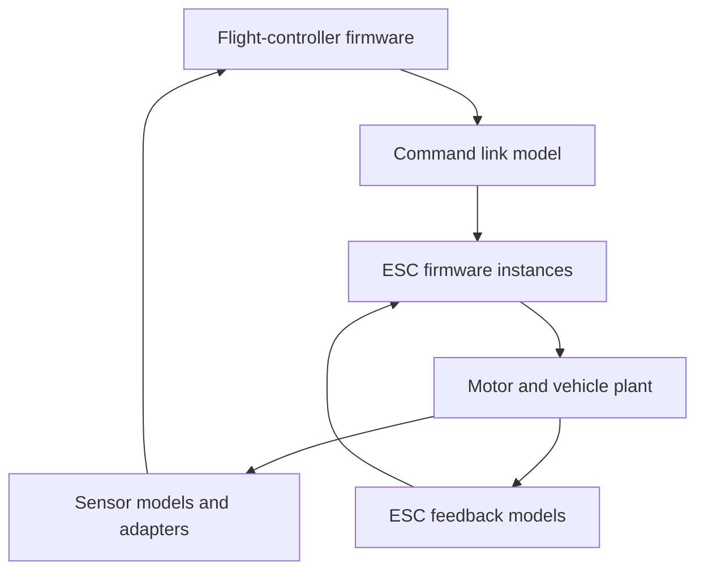

# A flight controller and real ESC firmware

**Status: proposed integration and evaluation target.** FastDyn's current vehicle, execution-control, and co-simulation mechanisms provide useful foundations. The inspected main revision does not ship a validated complete flight-controller-plus-ESCape32 experiment.

The target is a meaningful multi-firmware system: one flight-controller firmware instance issues motor commands to electronic speed controllers, each ESC executes its own firmware, and the resulting actuation drives a shared vehicle model. [ESCape32](https://github.com/neoxic/ESCape32) is the selected ESC project for this direction.

## Why this experiment matters

A flight-controller-only setup can send a normalized motor command directly to a plant. Introducing ESC firmware creates another executed software boundary between that command and the motor. The experiment can then investigate interactions among the flight controller, communication timing, ESC state, motor behavior, and feedback through the vehicle's sensors.

The resulting system is more informative than several isolated firmware instances. Its value comes from explicit connections and causal feedback. A command that never reaches a peer, or a plant that still consumes a bypassed flight-controller command, would not demonstrate the intended integration.

## Intended topology

The ESC node represents the required instances for the chosen vehicle. Each instance needs separate guest memory, device state, execution state, and output artifacts. The motor model may share the vehicle's physical state while preserving each motor's independent command and response.

## Build the experiment in observable stages

First, establish a standalone ESCape32 rehost for one pinned board target and firmware revision. Identify the architecture, image layout, startup requirements, timers, interrupt behavior, and relevant peripheral interfaces from that target. Do not infer complete ESC behavior from the project name alone.

Second, drive a documented command into that instance and observe the actual ESC software path that consumes it. Record the output boundary at which the ESC's behavior becomes an input to the motor model. The exact protocol and electrical abstraction depend on the selected firmware target and configuration.

Third, connect the flight-controller output to the ESC input and demonstrate that changes propagate through both binaries. Remove or disable the original direct flight-controller-to-plant path for the motor being tested. Otherwise the vehicle can appear responsive even when the new ESC path is unused.

Finally, add the remaining instances and the shared vehicle dynamics. Keep per-instance identities and traces so a result can be attributed to the appropriate controller and motor.

## Synchronize causality, not only process execution

Guest budgets can coordinate when instances yield to a controller. The exchange logic must also define when a produced command becomes visible to a consumer, how delayed data is queued, and when the plant advances. Deterministic tie-breaking is needed when two events occur at the same modeled time.

Record the selected communication fidelity: complete peripheral transactions, timed protocol messages, or a higher-level command boundary. Model-level delays should not be confused with host scheduling delays. Start with an explicit, bounded exchange step and refine it when a target behavior requires finer timing.

The [multiple-firmware chapter](../simulation/multiple-firmwares.md) describes current budget and controller mechanisms. It also explains why `fastdyn swarm` alone does not connect independent workers into this system.

## Assign the physical boundary carefully

The plant needs an actuator quantity with defined units and semantics. Depending on the experiment, the ESC interface might represent a control output to a motor model, a switching abstraction, or another justified intermediate quantity. The model must match what the selected firmware boundary produces.

The physical and sensor-model contract belongs with COMPOSE / CP Models. FastDyn supplies execution and the adapters that carry values between firmware and model. Avoid adding a second simulator process as a requirement when the plant can be embedded through the in-process FMU runtime.

A first integration can choose a manageable fidelity and state its limits. A later model may add motor electrical behavior, current sensing, back-EMF, thermal effects, or a more detailed command link when the research question requires them. These are proposed model choices, not current FastDyn claims.

## Evidence for a successful demo

| Claim | Evidence to collect |
| --- | --- |
| Both software layers execute | Per-instance instruction/function traces at the relevant command and output paths |
| The link is used | A controlled command change observed at producer, link, and consumer |
| ESC output drives the plant | Trace of the ESC-produced quantity and the corresponding plant input |
| Feedback reaches firmware | Plant state, generated sensor sample, and firmware consumption event |
| Runs are reproducible | Firmware/model digests, initial state, time policy, and command sequence |
| Multiple instances interact correctly | Instance identities, independent state, and event ordering |
| A fault has a causal effect | An injected link/ESC fault followed through the executed system and plant |

Useful final comparisons include the original direct-actuation baseline, one integrated ESC, and the full chosen vehicle. Report integration correctness before throughput and retain the traces that show which path actually ran.

## Existing foundations and selected target

- [FastDyn vehicle integration](https://github.com/boardrunner2049/FastDyn/blob/f9666d7f518c373e89831d8e14a6371a27fe6436/docs/FlightControllerSimulation.md)
- [Co-simulation slave contract](https://github.com/boardrunner2049/FastDyn/blob/f9666d7f518c373e89831d8e14a6371a27fe6436/docs/CoSimulationSlave.md)
- [Controller utility](https://github.com/boardrunner2049/FastDyn/blob/f9666d7f518c373e89831d8e14a6371a27fe6436/utils/cosim_lockstep.py)
- [Physics implementation](https://github.com/boardrunner2049/FastDyn/blob/f9666d7f518c373e89831d8e14a6371a27fe6436/virtuals/physics/README.md)
- [Selected ESC firmware: ESCape32](https://github.com/neoxic/ESCape32)
