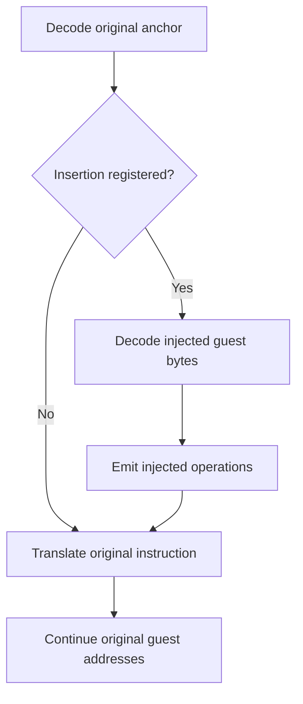

# Insert instructions during translation

**Status: proposed extension.** Current FastDyn has virtual callbacks, a modifier language, and specialized inline operations. The general byte-sequence insertion API described here is a design direction, not a callable API in the documented main revision.

The idea is simple: register additional **guest instructions** at an existing guest PC, and let the translator translate those instructions before the original instruction. The injected sequence contributes execution behavior without occupying new bytes in the firmware image. When the sequence is safe to emit inline, it can remain in the same translation block as the original code.

## The intended interface

The conceptual interface is:

```text
insert_before(guest_pc, instruction_bytes)
```

The CPU context supplies the target architecture and instruction mode. `instruction_bytes` contains encodings for that guest ISA, not host machine code and not a public TCG program. An assembler can be a convenience layer for producing the bytes; the core API does not require assembly text or a particular assembler.

For example, a sequence that computes a new argument value could run before the original call instruction. Inserting 100 extra instructions would increase the amount of translated work, but would not relocate the original call, change its symbol address, or move the next original instruction. There is no overwritten prologue or trampoline to fit into the firmware's bytes.

The count is an illustration of the address contract, not an unlimited translation-block size guarantee. The first milestone should reject an oversized emission before execution. Splitting a sequence across blocks is later work: it needs a resumable insertion cursor so a block boundary cannot replay or skip injected operations.

## Keep two positions distinct

The translator needs to distinguish an **anchor address in the original firmware** from the cursor used to decode the injected byte sequence. Advancing through the injected bytes must not advance the original firmware PC. After insertion, normal decoding resumes at the original instruction and then follows its original length and control-flow semantics.



The insertion changes architectural state deliberately. The original instruction observes the resulting register and flag state. It does not acquire a new address merely because more host operations execute before it.

## Architecture-neutral contract, target-specific mechanics

The shared layer should own registration, validation results, insertion ordering, lifetime, and diagnostics. Each target adapter should own the decoder integration and rules that depend on its ISA.

| Shared responsibility | Target-adapter responsibility |
| --- | --- |
| Anchor and sequence identity | ISA and instruction-mode validation |
| Registration before execution | Decoder/context integration |
| Stable sequence ordering | Register and flag effects |
| Plan generation and cache identity | Predication, delay slots, IT-state, and similar rules |
| Bounds and resource policy | Control-flow, exception, and PC-relative semantics |
| Clear unsupported-operation errors | Restoring original decode context after insertion |

The first implementation can support a limited instruction subset on one target while retaining this general API. Supporting another architecture should add an adapter and conformance tests, not redefine the public interface around ARM register names or Thumb instruction widths.

## A useful first milestone

Begin with deterministic straight-line register operations that the adapter can translate through its existing frontend. Register the insertion plan before execution, reject unsupported anchors or encodings, and emit the original instruction exactly once after the injected sequence.

This milestone avoids exposing the entire JIT to an extension author. The caller supplies familiar machine instructions; FastDyn controls their admission and the translator owns their meaning. Existing virtual callbacks remain appropriate for complex host-side behavior that does not benefit from this route.

The initial contract should explicitly reject instructions or anchor contexts whose effects cannot yet be preserved, including relevant branch, exception, PC-relative, or predication cases. An unsupported sequence should produce an explanation at preparation time. Quietly interpreting it differently would make the interface difficult to trust.

## Semantics that need explicit decisions

**Predication and execution conditions.** Specify whether an insertion inherits the anchor's execution predicate. A practical initial adapter can reject predicated or delay-slot-sensitive anchors until that behavior is defined. An insertion must not accidentally execute when the original instruction is architecturally skipped.

**PC-relative operations.** A sequence's decode offset is not automatically a valid guest-visible PC. Literal loads, address computations, and branches need a documented address policy. Initially rejecting these instructions is safer than silently deriving a value from an imaginary location in the firmware.

**Memory faults and exceptions.** If memory instructions become supported, preserve guest address translation, access permissions, ordering, and exception behavior. Diagnostic attribution can name the original anchor and the injected sequence offset without pretending those bytes exist in guest memory. Define partial-effect, restart, and interrupt-boundary semantics before admitting faulting sequences: returning to the same anchor must not accidentally repeat already committed effects.

**Time and observation.** Define whether injected operations affect instruction counts, coverage, stepping, and guest time. An insertion used for instrumentation should not silently change a controller's time base. An insertion intended to model work may need a different, explicit policy.

**Caching.** Translation blocks must correspond to the insertion plan that produced them. The first milestone can make plans immutable for the run. If later versions allow replacement, the affected cached translations must be invalidated; updating a host-side list alone does not change already translated code.

## What establishes a correct implementation

A demonstration should show that the injected effects occur in order, the original instruction still executes once, and original code addresses and image bytes remain unchanged. Exercise multiple sequences at one anchor, repeated execution of a cached block, rejection paths, and a long straight-line sequence.

A performance claim needs to establish whether the supported insertion stays in translated code, whether it introduces an exit or helper, and what cost remains. The property worth pursuing is precise: an admitted sequence becomes part of the translation and avoids a runtime callback when its semantics permit that.

## Existing foundations

- [Current modifier and translation instrumentation](https://github.com/boardrunner2049/FastDyn/blob/f9666d7f518c373e89831d8e14a6371a27fe6436/core/core.c)
- [Current virtual/modifier contract](https://github.com/boardrunner2049/FastDyn/blob/f9666d7f518c373e89831d8e14a6371a27fe6436/docs/VirtualsAndModifiers.md)
- [Native extension SDK](https://github.com/boardrunner2049/FastDyn/blob/f9666d7f518c373e89831d8e14a6371a27fe6436/include/fastdyn_runtime.h)
- [QEMU dependency pin](https://github.com/boardrunner2049/FastDyn/blob/f9666d7f518c373e89831d8e14a6371a27fe6436/.gitmodules)

These sources establish the current extension points. The general insertion interface and its semantics above are proposed work.
