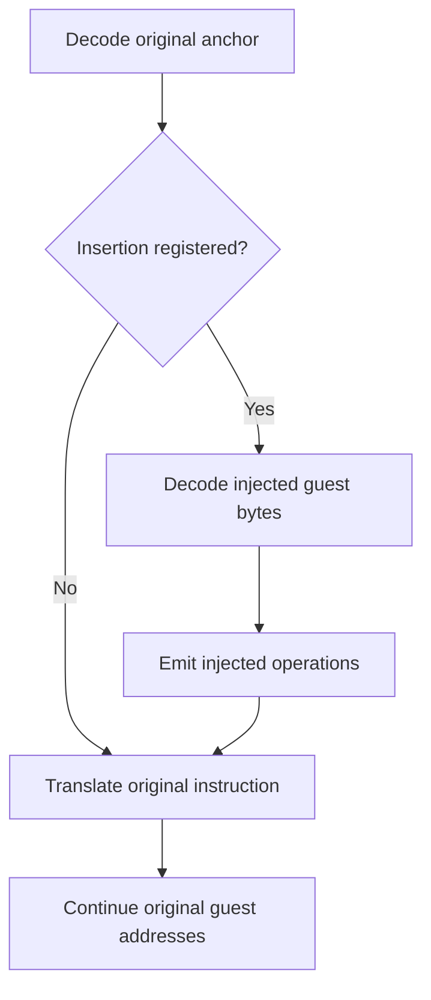

# Insert instructions during translation

**Status: implemented with a bounded instruction subset at FastDyn [`5b8bf3d`](https://github.com/boardrunner2049/FastDyn/commit/5b8bf3ddb01d63a4d5f86701d358e390a950cb9c).** The [JIT patcher](../advanced/jit-patcher.md) chapter covers the native API, supported profiles, and shipped example. This page explains the design: additional guest instructions become translated work at an existing firmware address while the original image and address layout remain intact.

## Add execution without moving the firmware

A plugin supplies encoded instructions for the guest ISA and an anchor PC. FastDyn validates the registration, and the patched QEMU frontend translates an admitted fragment immediately before the original instruction. The bytes are input to translation; they are not written into the firmware image or decoded as host machine code.

This is useful when a small register computation belongs directly in the translated path. A fragment can prepare an argument, mask a value, or adjust arithmetic state before an existing instruction consumes it. An assembler may produce the byte array during development, but the runtime API accepts bytes and an explicit encoding profile. It does not expose the full TCG interface.

Adding fragment operations increases the translated work at the site. It does not relocate functions, overwrite a prologue, or require a trampoline in guest memory. The original instruction retains its guest address, length, and plugin identity. Its ordinary fallthrough is still determined by that original instruction and the target architecture.

## Keep the anchor and decode cursor separate

The anchor identifies an instruction in the original image. The fragment cursor identifies a position in the additional byte sequence. Advancing the latter must not advance the firmware's decode position.

The frontend emits the accepted fragment into the same TCG stream, restores the original decode context, and translates the original instruction. Fragment offsets support diagnostics without becoming new guest addresses. The reader-visible API and the target adapters enforce this distinction together.

## One registration contract, explicit target profiles

`virtual_insert_before()` takes the guest PC, bytes, length, and a `FastDynCodeSpec` identifying ISA, instruction mode, and instruction byte order. The shared layer owns registration and lifecycle. Target-specific classifiers and decoders determine which encodings are admitted and preserve their architectural register and flag semantics.

| Contract | Implemented behavior |
| --- | --- |
| Identity | Match both the numeric guest PC and the complete encoding profile. Registrations for different modes at one address do not reinterpret each other's bytes. |
| Ownership | Copy the descriptor and byte buffer during registration. The caller does not need to keep its buffer alive. |
| Ordering | Apply matching fragments in registration order before the original instruction. |
| Lifetime | Seal registration when guest translation begins. Ordinary TB invalidation preserves the registry, and retranslation emits the matching fragments again. |
| Bounds | Limit each fragment and all matching fragments at a site/profile to 128 decoded instructions and 2048 input bytes. Both bounds apply. |
| Validation | Check descriptors, structure, and limits at registration; complete checks involving the live frontend, mode, extensions, and execution state during translation. Unsupported cases fail without a callback or interpreter fallback. |

The supported profiles span A32, Thumb, A64, x86, and RISC-V. Their admitted instruction subsets differ. Portability means selecting a supported target profile and valid encodings for it; it does not mean reusing one machine-code byte array across ISAs. The [JIT patcher support table](../advanced/jit-patcher.md) gives the concrete boundaries.

## Preserve the intended observation boundary

A fragment deliberately changes architectural state. Its register and flag effects can affect the original instruction, including the conditions under which that instruction acts. The implementation rejects matching Thumb insertions on an IT instruction or in active IT/ECI/ICI continuation state instead of assuming a universal predication rule.

The existing start-of-instruction observer runs before the fragments. The supported same-site observer classification is explicit; an arbitrary callback is not assumed to be read-only. Conflicting PC changes, detours, or unclassified callbacks are rejected before the affected TB executes.

Fragment operations do not add original guest instructions to plugin enumeration or `icount`. This preserves that counting boundary while allowing the fragment's effects to change the firmware's subsequent execution path. It is not a promise that the experiment's overall instruction count or time remains unchanged.

An exception retry that reaches the anchor again runs its fragments again. The contract is execution at the site, not exactly one fragment execution per retired original instruction. A test should therefore examine the relevant exception and retry behavior as well as the ordinary path.

## Work outside the current contract

The implemented subset excludes guest-memory operations, branches and other guest control transfers, privileged operations, floating point, and vectors. It also excludes live replacement/removal, automatic register preservation, host-state bindings, and a public TCG/IR interface. A plugin that needs those behaviors must use another supported mechanism or extend the implementation and its tests first.

This distinction matters for [automatic MMIO optimization](automatic-mmio.md): register-only guest fragments do not by themselves implement shared device-state access or prove a peripheral read is safe to replace. The [existing inline device path](../advanced/inline-device-modeling.md) has its own operation and backing-state contract.

## Source guide

- [Guest instruction fragment contract](https://github.com/boardrunner2049/FastDyn/blob/5b8bf3ddb01d63a4d5f86701d358e390a950cb9c/docs/GuestInstructionFragments.md)
- [Native SDK declaration](https://github.com/boardrunner2049/FastDyn/blob/5b8bf3ddb01d63a4d5f86701d358e390a950cb9c/include/fastdyn_runtime.h)
- [QEMU frontend, registration, and translation changes](https://github.com/boardrunner2049/FastDyn/blob/5b8bf3ddb01d63a4d5f86701d358e390a950cb9c/patches/qemu-fastdyn-insn-fragments.patch)
- [Public FastDyn plugin smoke](https://github.com/boardrunner2049/FastDyn/blob/5b8bf3ddb01d63a4d5f86701d358e390a950cb9c/tests/integration/run_fastdyn_guest_code_fragment_smoke.sh)
- [Direct-QEMU architecture matrix](https://github.com/boardrunner2049/FastDyn/blob/5b8bf3ddb01d63a4d5f86701d358e390a950cb9c/tests/integration/run_guest_code_fragments_smoke.sh)

The tests establish what the repository checks. They were inspected for this documentation update, not rerun as a new runtime qualification or performance experiment.
