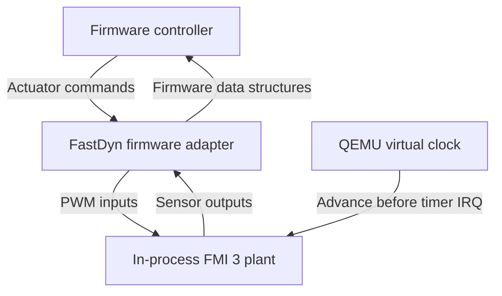

# Physics and FMUs

FastDyn can execute a controller's firmware and its physical environment in one simulation. Firmware produces actuator commands, a plant model evolves, and the resulting sensor values return to the firmware. The maintained vehicle path loads an FMI 3 Co-Simulation FMU directly into the FastDyn QEMU plugin. The physics calculation needs no separate simulator process.

That arrangement is useful for control-software analysis: the executable being studied remains the target firmware, while the environment can be inspected, parameterized, and changed. Optional MAVLink helpers and viewers provide automation and visualization without owning the plant's state.



## Build and select a plant

After completing [Installation](../getting-started/installation.md), run from the FastDyn repository root:

```bash
source ./setup.sh --build-qemu --with-rumoca
fastdyn run -c configs/copter462.toml
```

The setup prepares the pinned compiler and emulator dependencies. The configuration selects `FastDyn.Copter`; `auto_build = true` builds its FMU when needed. The same mechanism serves the Rover and Plane configurations described in [Flight controllers](flight-controllers.md).

This excerpt is already present in the copter configuration:

```toml
[FMU]
active = "quadrotor"
auto_build = true

[FMU.models.quadrotor]
model = "FastDyn.Copter"
model_file = "modelica/FastDyn/Copter.mo"
source_roots = ["third_party/common/modelica_models"]
output = "out/fmi3/Copter"
build = true
release = false
```

`active` selects a named entry. `fastdyn run -c <config> --fmu <name>` selects another entry for one run. To generate the artifact without launching the firmware, use:

```bash
python3 utils/build_fmi3_fmu.py --config configs/copter462.toml --fmu quadrotor
```

Keep the compiler revision, source models, and generated artifact together when recording an experiment. A successful export establishes that a model compiled, not that its parameters match a physical vehicle.

## Keep model ownership clear

COMPOSE/CP Models owns the reusable physical models and the shared vehicle-interface direction. FastDyn owns delivery to firmware, guest execution, firmware-specific adapters, and experiment orchestration. A change to a sensor's physical behavior belongs in the model layer; a change to how a particular firmware consumes that reading belongs in its adapter.

The documented main snapshot still contains FastDyn-specific wrapper models under `modelica/FastDyn/` and uses the pinned `modelica_models` dependency for base dynamics. It also contains FIRE composition profiles, where `physics_composition.py` invokes the external model composer and records compilation provenance. These are concrete existing integration paths; adopting a newer shared COMPOSE interface requires matching its exporter and FastDyn adapter together.

The P0/P1/P2 FIRE profiles expose different propulsion models. Use their manifests and validation records to determine the fidelity and compiler support of the selected profile. A profile filename alone is not evidence of a validated flight or of support for every vehicle geometry.

## The runtime contract

The Python launcher prepares the FMU and derives the native library, instantiation token, resources, and value references from that same package. This avoids combining a new binary with stale metadata. Current package loading supports Linux hosts on x86_64 and aarch64; the host architecture is distinct from the architecture of the guest firmware.

The native backend loads the shared library with `dlopen`, creates the FMI 3 instance, sets parameters and initial inputs, and calls `fmi3DoStep` during execution. Its current vehicle contract includes these named variables:

| Variables | Meaning in the maintained copter wrapper |
| --- | --- |
| `pwm` | Four actuator command values |
| `accel`, `gyro` | Body FRD acceleration in m/s² and angular velocity in rad/s |
| `mag` | Body FRD magnetic field in gauss |
| `gps`, `vel_ned`, `yaw_deg` | Latitude/longitude/altitude, NED velocity, and yaw |
| `baro_altitude_m`, `baro_pressure_pa`, `baro_temperature_c`, `baro_climb_rate_mps` | Barometric outputs |
| `lat0`, `lon0`, `ground_alt_wgs84`, `earth_radius_m` | Geodetic-origin parameters |

The launcher requires these names and configured parameter references. The runtime still assumes their expected types and shapes. It is a vehicle adapter, not an unrestricted importer for every FMI variable type.

Two implementation details matter when choosing experiments. The current backend accepts four PWM channels; do not infer a complete six-motor path from the presence of a hexa configuration. Its IMU callback fills the 17-element firmware batch using the current acceleration and gyro readings, so those slots are not 17 independently sampled historical observations.

## Time and fidelity

The maintained ArduPilot configuration uses:

```toml
[Machine]
icount = { shift = 5, sleep = false, align = false }
timer_irq_period_ns = 1000000
```

At each periodic IRQ, FastDyn asks the FMU to advance to QEMU's current virtual time before delivering the interrupt. Actuator writes update staged inputs. The native backend limits each internal step request to 2 ms, subdividing a larger advance. With the configured 1 ms tick, the normal advance interval is already smaller.

Keep three quantities distinct: host execution time, QEMU virtual time, and the plant's integration interval. Changing the board tick changes what the firmware observes. Changing `icount.shift` changes the relationship between guest instruction execution and virtual time. Neither supplies cycle-accurate timing for a physical MCU.

Model validation should therefore check units, frame conventions, actuator ordering, initial conditions, and convergence as the integration interval changes. Also distinguish datasheet-derived parameters, calibrated parameters, and behavior validated against measurements. The supplied copter's motor lag, ground contact, and sensor biases are explicit model choices that can be studied and refined.

## Extending the backend

`phy_backend_t` in `virtuals/physics/phy.h` defines the current native interface. Implement its applicable sensor, actuator, lifecycle, and `advance_simulation` callbacks, then register the backend in `phy.c`. Use the header rather than copying older prose signatures. Gazebo remains an alternative path for existing experiments; the in-process FMU path is the starting point for new vehicle work.

See [Branch previews](branch-previews.md) for newer integration work that is separate from this documented main revision.

## Source guide

- [Copter model and physical conventions](https://github.com/boardrunner2049/FastDyn/blob/f9666d7f518c373e89831d8e14a6371a27fe6436/modelica/FastDyn/Copter.mo)
- [FMU build and required variable names](https://github.com/boardrunner2049/FastDyn/blob/f9666d7f518c373e89831d8e14a6371a27fe6436/src/fastdyn/fmu_build.py)
- [Package-consistent runtime preparation](https://github.com/boardrunner2049/FastDyn/blob/f9666d7f518c373e89831d8e14a6371a27fe6436/src/fastdyn/fmu_runtime.py)
- [Native FMI execution and current shape limits](https://github.com/boardrunner2049/FastDyn/blob/f9666d7f518c373e89831d8e14a6371a27fe6436/virtuals/physics/physics_engines/fmu/fmu.c)
- [Physics backend interface](https://github.com/boardrunner2049/FastDyn/blob/f9666d7f518c373e89831d8e14a6371a27fe6436/virtuals/physics/phy.h)
- [Timer-driven physics advance](https://github.com/boardrunner2049/FastDyn/blob/f9666d7f518c373e89831d8e14a6371a27fe6436/virtuals/virtuals.c)
